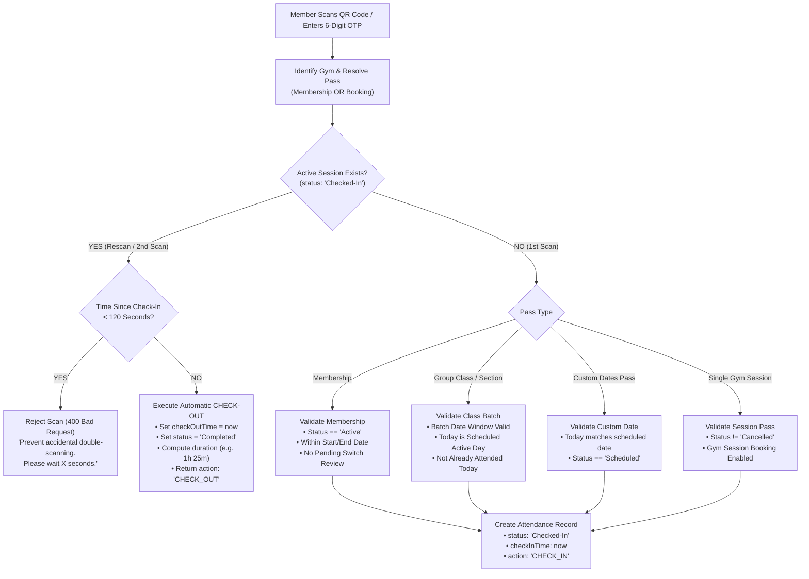

# Unified Attendance Check-In & Check-Out Specification

This document details the unified attendance check-in and check-out architecture for the **GYMEZY** platform across all member pass types: **Memberships**, **Single Sessions**, **Custom Date Passes**, and **Group Classes / Section Batches**.

---

## 1. Architectural Overview & The Smart Toggle Paradigm

Attendance in GYMEZY is designed around an **autonomous tap-in / tap-out toggle**. Members can use either the **dynamic QR code** generated on their mobile device or a **6-digit entry OTP**.

Gym turnstiles, front desk scanners, and owner devices interact with a single unified entry point:
`POST /api/v1/attendance/check-in`



---

## 2. Pass Type Support Matrix

The attendance engine unifies all pass types into a standardized verification and recording pipeline:

| Pass Type | Database Model | Identifier Resolution | Validation Rules Enforced | Second Scan Behavior |
|---|---|---|---|---|
| **Gym Membership** | `Membership` | `entryOtp`, MongoDB `_id`, or `membershipId` (e.g., `MEM001`) | • Status must not be `Cancelled`<br/>• Plan switch must not be pending review<br/>• Current date must fall within `startDate` and `endDate` | Automatically checks out member, marks status `'Completed'`, and calculates total workout time. |
| **Group Class / Section Batch** | `Booking` (`bookingType: 'GROUP_CLASS'` or `'SECTION'`) | `entryOtp`, MongoDB `_id`, or `bookingId` (e.g., `BK101`) | • Batch start/end date window valid<br/>• Current day matches section `activeDays` (e.g., Mon, Wed, Fri)<br/>• Member has not already attended today<br/>• Increments `attendedSessionsCount` | Automatically checks out member from the group class/section room. |
| **Custom Date Session Pass** | `Booking` (`isCustomDates: true`) | `entryOtp`, `customDates.dailyOtp`, `bookingId`, or `_id` | • Current date matches one of the booked `customDates`<br/>• Session for today is not already marked `Attended`<br/>• Marks specific date slot as `Attended` | Automatically checks out member for that specific date session. |
| **Single Gym Session / Day Pass** | `Booking` (`bookingType: 'GYM_SESSION'`) | `entryOtp`, `bookingId`, or `_id` | • Status must not be `Cancelled`<br/>• Single-session booking enabled by gym<br/>• Increments `attendedSessionsCount` | Automatically checks out member and records session duration. |

---

## 3. Check-In & Check-Out Lifecycle Rules

### Phase 1: First Scan (Check-In)
1. Resolves the target gym using `gymId`.
2. Inspects input token (QR code JSON string, 6-digit numeric OTP, or pass ID).
3. Looks up `Membership` first; if not found, queries `Booking`.
4. Executes pass-specific validation checks (date bounds, active class days, attendance caps).
5. Creates a new [`Attendance`](file:///Users/yovelr/Softrate/GYMEZY/middleware/src/models/attendance.model.js) record:
   - `userId`: Target user's ObjectId
   - `gymId`: Gym's ObjectId
   - `membershipId` / `bookingId`: Linked pass reference
   - `checkInTime`: Current timestamp
   - `status`: `'Checked-In'`
   - `area`: Pass title, section title, or area name (e.g., `Group Class - CrossFit Morning Batch`)
6. Returns `action: "CHECK_IN"` with member profile and pass details.

---

### Phase 2: Anti-Double-Scan Cooldown Guard (120-Second Window)
To prevent hardware turnstiles, barcode scanners, or camera auto-focus from triggering immediate check-outs when a member walks in:
- If a subsequent scan occurs within **120 seconds (2 minutes)** of `checkInTime`:
  - Request is rejected with `400 Bad Request`.
  - Error message: `Member was checked in X seconds ago. To prevent accidental double-scanning, please wait Y seconds before checking out.`
  - The active session remains in `'Checked-In'` status.

---

### Phase 3: Second Scan (Check-Out)
When the member finishes their workout and scans the exit QR scanner:
1. System discovers the active record where `userId = targetUserId`, `gymId = gym._id`, and `status = 'Checked-In'`.
2. Verifies elapsed time is $\ge 120$ seconds.
3. Closes the active session:
   - `checkOutTime`: Current timestamp
   - `status`: `'Completed'`
   - Calculates duration string (e.g., `45 mins` or `1h 30m`).
4. Returns `action: "CHECK_OUT"` with total duration and departure confirmation.

---

### Phase 4: Stale Session Sweeper (Automatic Cron Cleanup)
If a member forgets to scan on departure:
- The background service [`attendanceCron.service.js`](file:///Users/yovelr/Softrate/GYMEZY/middleware/src/services/attendanceCron.service.js) runs periodic cleanups.
- Any open attendance record with `status: 'Checked-In'` older than **4 hours** is automatically completed:
  - `status`: `'Completed'`
  - `checkOutTime`: Estimated as `checkInTime + 2 hours`

---

## 4. API Specification

### Endpoint: Unified Check-In / Check-Out
- **Method**: `POST`
- **Route**: `/api/v1/attendance/check-in`
- **Auth**: Protected (Gym Staff / Turnstile Scanner / Gym Owner)

#### Request Body
```json
{
  "gymId": "664fa7...",
  "code": "BK10023",
  "otp": "489201",
  "method": "QR",
  "area": "Main Floor",
  "verifiedBy": "Turnstile Scanner 1"
}
```

#### Successful Check-In Response (`201 Created`)
```json
{
  "success": true,
  "statusCode": 201,
  "message": "Check-in verified successfully. Access granted.",
  "data": {
    "action": "CHECK_IN",
    "attendanceId": "6650b2...",
    "status": "Granted",
    "attendanceStatus": "Checked-In",
    "checkInTime": "2026-11-02T10:00:00.000Z",
    "method": "QR",
    "area": "Group Class - Zumba Evening",
    "member": {
      "id": "6631e8...",
      "name": "Alex Johnson",
      "phone": "+91 9876543210",
      "avatar": "https://...",
      "bookingId": "BK10023",
      "bookingType": "GROUP_CLASS",
      "title": "Zumba Evening",
      "status": "Active",
      "attendedSessionsCount": 3,
      "durationDays": 12
    }
  }
}
```

#### Successful Check-Out Response (`200 OK`)
```json
{
  "success": true,
  "statusCode": 200,
  "message": "Check-out recorded successfully for Alex Johnson! Duration: 1h 15m",
  "data": {
    "action": "CHECK_OUT",
    "attendanceId": "6650b2...",
    "status": "Checked-Out",
    "attendanceStatus": "Completed",
    "checkInTime": "2026-11-02T10:00:00.000Z",
    "checkOutTime": "2026-11-02T11:15:00.000Z",
    "durationStr": "1h 15m",
    "method": "QR",
    "area": "Group Class - Zumba Evening",
    "member": {
      "id": "6631e8...",
      "name": "Alex Johnson",
      "phone": "+91 9876543210",
      "avatar": "https://...",
      "bookingId": "BK10023"
    }
  }
}
```

---

## 5. Explicit Check-Out Endpoint

For administrative dashboards or front desk checkouts where staff manually check out a member:
- **Method**: `POST`
- **Route**: `/api/v1/attendance/check-out`
- **Payload**: Provide either `attendanceId`, or `(userId, gymId)`, or `(membershipId, gymId)`.

```json
{
  "attendanceId": "6650b2..."
}
```

---

## 6. Error & Validation Codes

| HTTP Status | Reason / Error Message | Cause |
|---|---|---|
| `400 Bad Request` | `To prevent accidental double-scanning, please wait X seconds before checking out.` | Second scan triggered within the 120-second debounce window. |
| `400 Bad Request` | `Today (Day) is not an active session day for this section.` | Group class or section batch is scheduled only on specific days (e.g., Tue/Thu). |
| `400 Bad Request` | `Member has already attended their scheduled session for this section today.` | User already checked in and checked out of their scheduled class session today. |
| `400 Bad Request` | `This section batch starts on [Date]. Entry is not permitted before start date.` | Member attempted entry prior to batch start. |
| `400 Bad Request` | `This membership pass has been cancelled.` / `Membership has expired.` | Non-active membership status. |
| `400 Bad Request` | `Your membership plan switch request is currently under review.` | Member has an in-flight upgrade/downgrade awaiting approval. |
| `404 Not Found` | `No active membership, session, or section pass found matching this Pass/OTP.` | QR code or OTP does not match any valid user record for the gym. |

