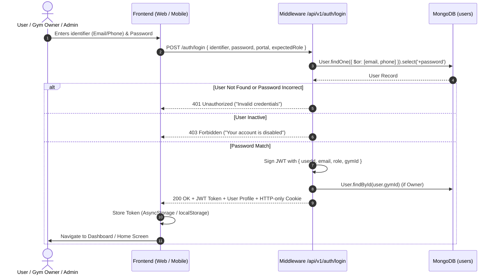
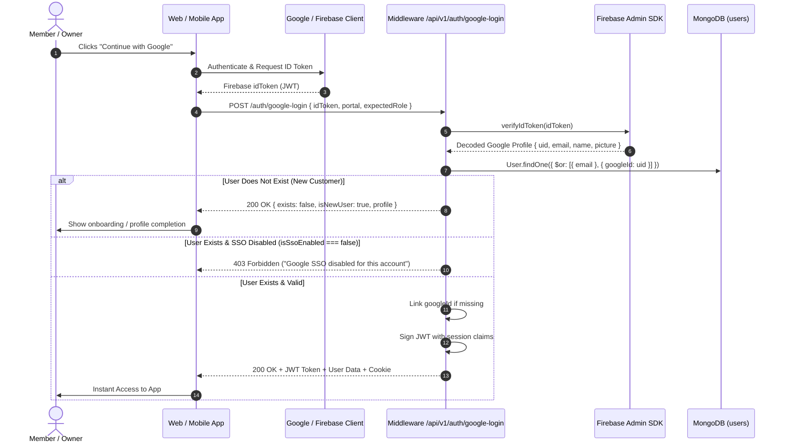
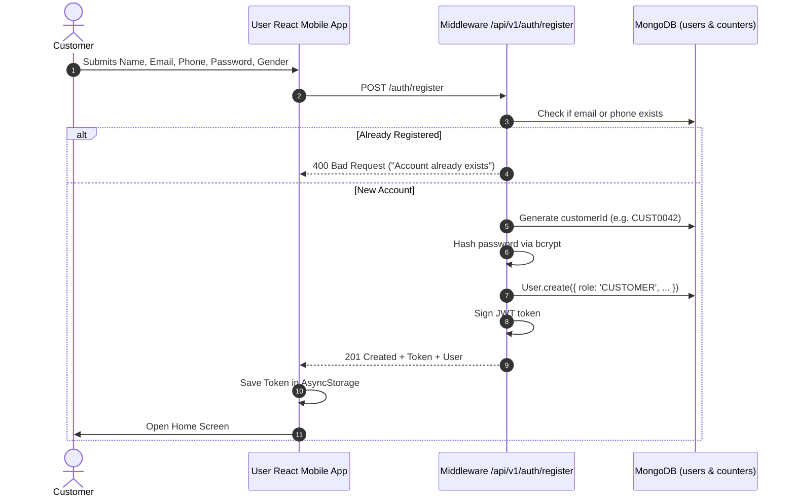

# GYMEZY Authentication & Authorization Architecture

This document specifies the end-to-end authentication, session management, biometric security, Google SSO, and role-based access control (RBAC) across all GYMEZY platforms.

---

## Table of Contents
1. [Overview & Security Principles](#1-overview--security-principles)
2. [Platform Roles & Access Matrix](#2-platform-roles--access-matrix)
3. [Authentication Flows](#3-authentication-flows)
   - [A. Standard Email / Phone & Password Login](#a-standard-email--phone--password-login)
   - [B. Google SSO (Firebase Admin SDK) Flow](#b-google-sso-firebase-admin-sdk-flow)
   - [C. Customer Self-Registration](#c-customer-self-registration)
   - [D. Gym Partner Self-Registration & Onboarding](#d-gym-partner-self-registration--onboarding)
   - [E. Mobile Biometric / Face ID Authentication](#e-mobile-biometric--face-id-authentication)
4. [Session Lifecycle & Token Storage](#4-session-lifecycle--token-storage)
5. [Token Validation & Authorization Middleware](#5-token-validation--authorization-middleware)
6. [API Endpoints Reference](#6-api-endpoints-reference)

---

## 1. Overview & Security Principles

The GYMEZY authentication subsystem is designed to meet enterprise multi-tenant standards:
- **Stateless JWT with Dual Storage Strategy**:
  - Web Portals receive both an **HTTP-only, SameSite Secure cookie** and a JSON payload containing the JWT token (stored in `localStorage` for immediate cross-tab header propagation).
  - Mobile Apps receive the JWT token and persist it securely in encrypted device storage (`AsyncStorage`).
- **No Plaintext Passwords**:
  - Passwords are hashed using **bcrypt** with a salt factor of `10`.
  - The `password` field in `User` Mongoose schema has `select: false` so credentials are never leaked in standard queries.
- **Unified Identity Model**:
  - A single `User` collection manages Super Admins, Gym Owners, Employees/Trainers, and Customers.
  - Multi-tenant isolation is guaranteed through `gymId` and `role` claims bound directly into the token and validated at every route.
- **Fail-Safe SSO Policy**:
  - Google SSO verification uses Firebase Admin SDK on the backend.
  - Gym Owners can selectively enable or disable Google SSO login for their account via `/api/v1/auth/toggle-sso`.

---

## 2. Platform Roles & Access Matrix

| Role Constant | Value | Target Client App | Access Permissions |
|---|---|---|---|
| `SUPER_ADMIN` | `SUPER_ADMIN` | Super Admin Web (`/admin/*`) | Global platform access, verify gym registrations, inspect audit logs, override plans, financial settlement. |
| `GYM_OWNER` | `GYM_OWNER` | Gym Owner Web & Mobile (`/owner/*`) | Manage own gym facility, trainers, section batches, review plan switch requests, day pass pricing. |
| `EMPLOYEE` / `TRAINER` | `EMPLOYEE` / `TRAINER` | Gym Owner Mobile / Staff Console | Manage assigned section schedules, track member QR attendance, log workouts. |
| `CUSTOMER` | `CUSTOMER` | User Mobile App (`user-react`) | Discover verified gyms, buy memberships, request plan switches, book day passes, biometric QR check-in. |

---

## 3. Authentication Flows

### A. Standard Email / Phone & Password Login



---

### B. Google SSO (Firebase Admin SDK) Flow



---

### C. Customer Self-Registration



---

### D. Gym Partner Self-Registration & Onboarding

1. Partner fills business verification form (Gym Name, Trade Address, KYC, GST/PAN) at `/register` on Gym Owner Web.
2. Endpoint `POST /api/v1/gyms/register` creates:
   - `User` record with role `GYM_OWNER`.
   - `Gym` record linked to `ownerId` with `approvalStatus: 'Pending Approval'`.
3. The Owner is redirected to `/application-status` with real-time stepper.
4. Super Admin inspects KYC documents at `/admin/gyms` and clicks **Approve**.
5. Gym state transitions to `Approved` and `status: 'Active'`. The Owner Console unlocks immediately.

---

### E. Mobile Biometric / Face ID Authentication

1. **Hardware Verification**:
   The app checks `expo-local-authentication`:
   - `hasHardwareAsync()`: Confirms device sensor exists.
   - `isEnrolledAsync()`: Confirms user registered fingerprints or Face ID in device settings.
2. **Native Prompt**:
   Calls `authenticateAsync({ promptMessage: 'Verify identity to login' })`.
3. **Local & Cloud Persistence**:
   - Updates local preference: `AsyncStorage.setItem('@gymezy_pref_biometric_login', 'true')`.
   - Updates backend database: `PATCH /api/v1/auth/profile` with `{ preferences: { biometricLogin: true }, biometricEnabled: true }`.
4. **Fast Turnstile Check-In**:
   On the member's digital pass card, pressing **"Biometric Fast Check-In"** performs quick biometric verification to unmask the dynamic turnstile QR code / entry OTP.

---

## 4. Session Lifecycle & Token Storage

### Token Payloads
The signed JWT payload contains:
```json
{
  "userId": "6ac383e137fe6d51b1cea450",
  "id": "6ac383e137fe6d51b1cea450",
  "_id": "6ac383e137fe6d51b1cea450",
  "email": "customer@gymezy.com",
  "role": "CUSTOMER",
  "gymId": null,
  "iat": 1730531200,
  "exp": 1731136000
}
```

### Expiry Configuration (`.env`)
- `JWT_EXPIRES_IN=7d`: Access tokens are valid for 7 days.
- `COOKIE_EXPIRES_DAYS=7`: HTTP-only cookie lifecycle matches JWT validity.

### Logout Flow
1. Client calls `POST /api/v1/auth/logout`.
2. Middleware clears the HTTP-only cookie `res.clearCookie('gymezy_auth_token')`.
3. Client removes token and cached user object from storage:
   - Web: `localStorage.removeItem('gymezy_auth_token')`
   - Mobile: `AsyncStorage.multiRemove(['gymezy_auth_token', '@gymezy_fcm_token'])`

---

## 5. Token Validation & Authorization Middleware

### Priority Extraction in [`auth.middleware.js`](file:///Users/yovelr/Softrate/GYMEZY/middleware/src/middlewares/auth.middleware.js)
1. **Authorization Header**: `Bearer <token>` (Primary for mobile & decoupled portal tabs).
2. **Custom Headers**: `x-access-token` or `x-auth-token`.
3. **HTTP-only Cookie**: `req.cookies.gymezy_auth_token`.

### Role Guard Middleware (`authorizeRoles`)
Routes are protected by combining `authenticate` with `authorizeRoles(...)`:
```javascript
router.put(
  '/gyms/:id',
  authenticate,
  authorizeRoles(USER_ROLES.GYM_OWNER, USER_ROLES.SUPER_ADMIN),
  updateGym
);
```

---

## 6. API Endpoints Reference

| Route | Method | Access | Description |
|---|---|---|---|
| `/api/v1/auth/login` | `POST` | Public | Authenticate via Email/Phone + Password |
| `/api/v1/auth/google-login` | `POST` | Public | Authenticate via Firebase Google ID Token |
| `/api/v1/auth/register` | `POST` | Public | Customer self-registration |
| `/api/v1/auth/check-email` | `GET / POST` | Public | Check email availability in real-time |
| `/api/v1/auth/me` | `GET` | Authenticated | Retrieve authenticated user profile & gym details |
| `/api/v1/auth/profile` | `PATCH / PUT` | Authenticated | Update user profile, preferences & biometric flag |
| `/api/v1/auth/toggle-sso` | `PATCH` | Authenticated | Enable or disable Google SSO for account |
| `/api/v1/auth/link-google` | `POST` | Authenticated | Link an existing account to a Google account |
| `/api/v1/auth/logout` | `POST` | Public / Auth | Clear auth cookies and invalidate session |

