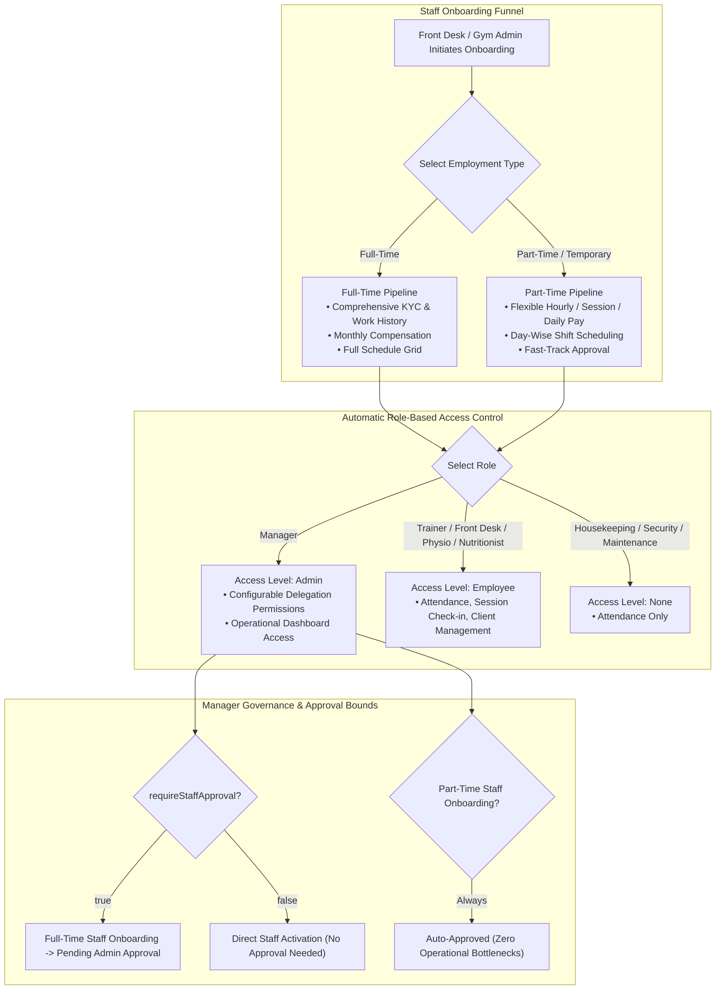
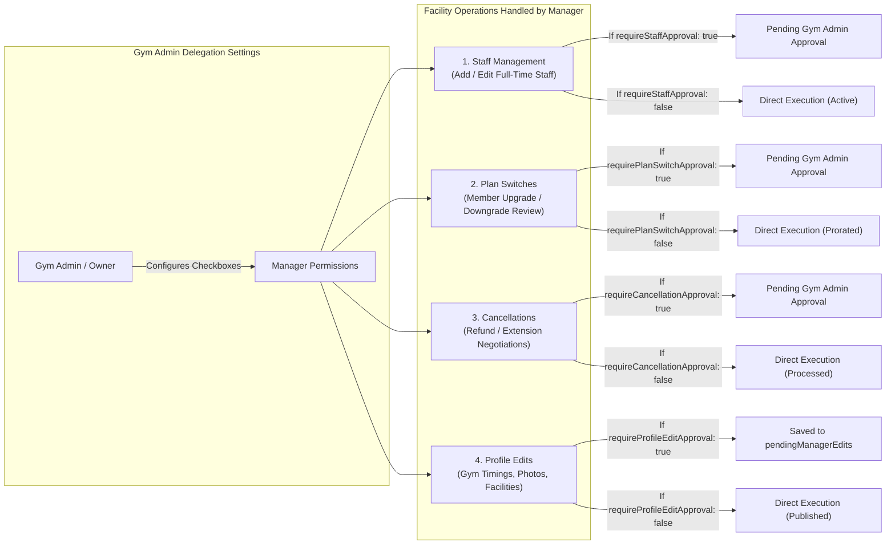
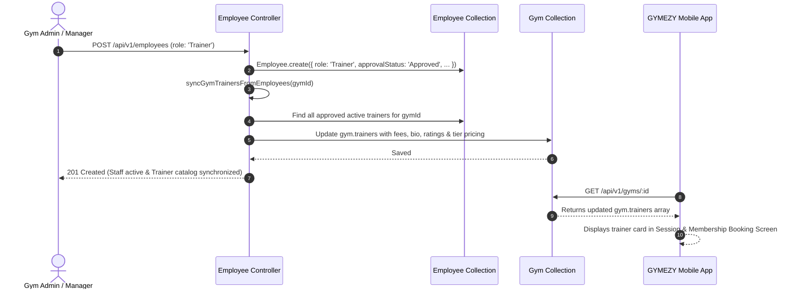

# GYMEZY Employee Onboarding & Manager Delegation Specification

This document details the architecture, lifecycle, permission delegation engine, and operational workflows for **Full-Time and Part-Time Employee Onboarding** and the **Manager Role** across the GYMEZY platform.

---

## 1. System Architecture Overview

The GYMEZY staff management system supports multi-role gym operations with automated role-based access control (RBAC), sequential employee identification, split onboarding pipelines (Full-Time vs. Part-Time/Temporary), and a 4-tier granular delegation model for Gym Managers.



---

## 2. Employee Taxonomy & Sequential ID Generation

### 2.1 Role Taxonomy & Access Types

Staff roles automatically map to system permissions using `computeAccessTypeFromRole`:

| Role Name | System Access Type | Default Capabilities | Turnstile / App Permissions |
|---|---|---|---|
| **Gym Manager** | `Admin` | Full operational access: bookings, memberships, attendance, staff oversight, switch & cancellation reviews | Owner Web Portal, Owner Mobile App (Delegated Admin) |
| **Trainer / Head Trainer** | `Employee` | Client rosters, training schedules, session check-ins, tier pricing catalog | Gym Owner Mobile App (Trainer Profile), Public Member Discovery |
| **Front Desk / Receptionist** | `Employee` | QR scanner, manual OTP check-in, phone-based walk-in booking creation | Owner Web Turnstile, Desk Operations |
| **Physiotherapist / Nutritionist** | `Employee` | Consultation schedules, client tracking, specialized session logs | Gym Owner Mobile App |
| **Housekeeping / Security / Maintenance** | `None` | Shift logs, biometric / manual staff attendance | Attendance Tracking Only |

### 2.2 Isolated Sequential Employee ID Generation

Every employee receives a clean, gym-scoped sequential ID (`EMP001`, `EMP002`, or `TR001`, `TR002` for Trainers):

```javascript
// Generated in generateSequentialEmpId(gymId, gymPartnerId, role)
const rolePrefix = String(role).trim().toLowerCase().includes('trainer') ? 'TR' : 'EMP';
const nextSeq = maxNum + 1;
return `${rolePrefix}${String(nextSeq).padStart(3, '0')}`;
```

---

## 3. Full-Time vs. Part-Time Employee Onboarding

GYMEZY provides two distinct onboarding pipelines based on employment type:

```mermaid
graph TD
    subgraph FullTime["Full-Time Employee Onboarding"]
        F1["Personal Information\n(Name, Gender, Phone, Email, Avatar)"]
        F2["Employment Contract\n(Monthly Salary, Fixed Working Hours, Join Date)"]
        F3["Verification & KYC\n(Aadhaar / PAN / Passport, Trainer Certifications)"]
        F4["Experience & Portfolio\n(Past Employers, Designations, Specialties, Bio)"]
        F1 --> F2 --> F3 --> F4
    end

    subgraph PartTime["Part-Time & Temporary Onboarding"]
        P1["Personal Information\n(Name, Contact Number, Role)"]
        P2["Flexible Compensation\n(Hourly, Per-Session, or Daily Rate)"]
        P3["Custom Day-Wise Shifts\n(Specific Days & Dynamic Hour Blocks)"]
        P4["Immediate Activation\n(Bypasses Admin Queue for Fast Front-Desk Staffing)"]
        P1 --> P2 --> P3 --> P4
    end
```



### 3.1 Pipeline Comparison Matrix

| Feature | Full-Time Employee | Part-Time / Temporary Employee |
|---|---|---|
| **Compensation Model** | Fixed Monthly Salary (`payFreq: 'Monthly'`) | Hourly (`'Hourly'`), Per-Session (`'Session'`), or Daily (`'Daily'`) |
| **Schedule Grid** | Standard 6-day or 5-day regular shifts (e.g. 09:00 AM – 06:00 PM) | Day-wise customized hours (`dayWiseHours: [{ day, startTime, endTime }]`) |
| **KYC & Documents** | Mandatory Aadhaar/PAN upload, emergency contact verification | Optional lightweight document attachment |
| **Trainer Showcase** | Public bio, certifications, ratings, and tier pricing catalog | Hourly or per-session rate for substitute coverage |
| **Manager Onboarding Gate** | Subject to `requireStaffApproval` review queue if submitted by Manager | **Auto-Approved (`approvalStatus: 'Approved'`)** to prevent front-desk staffing delays |

---

## 4. Manager Role Architecture & Delegation Engine

A **Gym Manager** is an employee empowered with administrative authority over facility operations. To prevent unauthorized operational risks while maintaining day-to-day speed, GYMEZY utilizes an **Autonomous 4-Tier Delegation Engine**.

### 4.1 Granular Delegation Permissions

Configured per Manager in [`employee.model.js`](../middleware/src/models/employee.model.js):

```javascript
managerPermissions: {
  requireStaffApproval: { type: Boolean, default: true },
  requirePlanSwitchApproval: { type: Boolean, default: true },
  requireCancellationApproval: { type: Boolean, default: true },
  requireProfileEditApproval: { type: Boolean, default: true },
}
```



### 4.2 Manager Action Flow & Audit Trail

When a Manager with `requireStaffApproval: true` creates or edits a Full-Time employee:
1. `approvalStatus` is set to `'Pending Approval'`.
2. `pendingAction` is set to `'NEW_EMPLOYEE'` or `'EDIT_DETAILS'`.
3. `submittedByManager` stores the manager's audit metadata:
   ```json
   {
     "managerId": "672879a834b9d031cba41e10",
     "managerName": "Karthik Raja (Manager)",
     "submittedAt": "2026-11-04T06:15:20.000Z"
   }
   ```
4. Draft field modifications are stored in `pendingChanges` (the live record remains untouched until approved).
5. An immutable audit record is appended to `auditHistory`.
6. Gym Admin receives an alert badge in the Owner Portal and can Approve or Reject with remarks via `PATCH /api/v1/employees/:id/approval`.

---

## 5. Trainer Catalog Synchronization Pipeline

Trainers represent a specialized subclass of employees. When a staff member is created with `role: 'Trainer'` and achieves `'Approved'` status, the backend automatically mirrors their profile into the parent gym's embedded `trainers` array:



### Synchronized Trainer Fields
- **Tier Pricing Mapping**: `Monthly`, `Quarterly`, `Half-Yearly`, and `Annual` personal training fees.
- **Single Session Fee**: Standard rate for per-session personal training pass.
- **Showcase Data**: Profile avatar, experience years, certifications, languages spoken, and star rating.
- **Working Schedule**: Available days of week and working hours window.

---

## 6. API Reference & Request / Response Contracts

### 6.1 Create Employee / Manager / Trainer
- **Endpoint**: `POST /api/v1/employees`
- **Access**: Gym Owner, Gym Admin, Delegated Manager

#### Request Payload: Manager with Granular Delegation
```json
{
  "name": "Suresh Raina",
  "role": "Manager",
  "phone": "+91 9876543211",
  "email": "suresh.manager@gymezy.com",
  "type": "Full-Time",
  "joinDate": "04 Nov 2026",
  "managerPermissions": {
    "requireStaffApproval": true,
    "requirePlanSwitchApproval": false,
    "requireCancellationApproval": true,
    "requireProfileEditApproval": false
  },
  "compensation": {
    "payType": "Monthly",
    "payAmount": 35000,
    "payFreq": "Monthly"
  },
  "schedule": {
    "workingDays": ["Mon", "Tue", "Wed", "Thu", "Fri", "Sat"],
    "workingTimeStart": "08:00 AM",
    "workingTimeEnd": "05:00 PM"
  }
}
```

#### Request Payload: Part-Time Trainer
```json
{
  "name": "Ananya Roy",
  "role": "Trainer",
  "phone": "+91 9840199887",
  "email": "ananya.roy@example.com",
  "type": "Part-Time",
  "specialty": "Zumba & Functional Fitness",
  "experienceYears": 3,
  "compensation": {
    "payType": "Hourly",
    "payAmount": 500,
    "payFreq": "Per Hour"
  },
  "schedule": {
    "isDifferentDays": true,
    "dayWiseHours": [
      { "day": "Mon", "startTime": "06:00 AM", "endTime": "09:00 AM" },
      { "day": "Wed", "startTime": "06:00 AM", "endTime": "09:00 AM" },
      { "day": "Fri", "startTime": "06:00 AM", "endTime": "09:00 AM" }
    ]
  },
  "trainerPricing": {
    "singleSession": 250,
    "monthly": 1500
  }
}
```

#### Response (201 Created)
```json
{
  "success": true,
  "message": "Employee created and active.",
  "data": {
    "_id": "672880c134b9d031cba41e88",
    "employeeId": "TR004",
    "gymPartnerId": "GYM1",
    "name": "Ananya Roy",
    "role": "Trainer",
    "type": "Part-Time",
    "accessType": "Employee",
    "approvalStatus": "Approved",
    "status": "Active",
    "attendance": "Present"
  }
}
```

---

### 6.2 Review Employee Onboarding / Edit Approval
- **Endpoint**: `PATCH /api/v1/employees/:id/approval`
- **Access**: Gym Owner, Gym Admin, Super Admin

#### Request Payload
```json
{
  "decision": "Approved",
  "adminRemarks": "Credentials and Aadhaar verification complete. Approved."
}
```

#### Response (200 OK)
```json
{
  "success": true,
  "message": "Employee Approved successfully.",
  "data": {
    "_id": "672880c134b9d031cba41e88",
    "employeeId": "EMP012",
    "name": "Vikram Singh",
    "role": "Trainer",
    "approvalStatus": "Approved",
    "pendingAction": "NONE",
    "approvedBy": "Gym Owner Admin",
    "approvedAt": "2026-11-04T06:22:10.150Z"
  }
}
```

---

## 7. Portal UI Reference: Gym Owner Web

In [`web-application/gym-owner/src/owner/components/EmployeeManagement.jsx`](../web-application/gym-owner/src/owner/components/EmployeeManagement.jsx):

1. **Add Employee Modal**:
   - `Role` selector triggers `computeAccessTypeFromRole`. When `role: 'Manager'` is chosen, the purple **Manager Delegation Permissions** card dynamically expands with 4 toggles.
   - `Employment Type` selector allows choosing between `Full-Time`, `Part-Time`, and `Temporary`.
   - Selecting `Part-Time` dynamically adjusts the Compensation block to Hourly / Per-Session / Daily rates and displays day-wise shift pickers.
2. **Employee Listing Table**:
   - Columns display `Employee ID`, `Name & Avatar`, `Role`, `Employment Type` (`Full-Time` vs `Part-Time`), `Attendance`, `Status`, and `Approval Status`.
   - `Pending Approval` badges highlight staff awaiting Gym Admin review.
3. **Pending Approvals Drawer**:
   - Dedicated filter view for Gym Admin displaying manager submissions, diff comparison of requested edits, and 1-click **Approve** or **Reject** actions.
4. **Role-Conditional Field Visibility**:
   - **For Managers & Operational Roles (`Manager`, `Front Desk`, `Security`, etc.)**:
     - Trainer-specific showcase fields (`About Me`, `Services Offered`, `Certifications`) and the `Trainer Certificate` table are **hidden**.
     - Only managerial permissions (`requireStaffApproval`, `requirePlanSwitchApproval`, `requireCancellationApproval`, `requireProfileEditApproval`) and standard administrative employment/identity documents (`Aadhaar/ID Proof`, `Offer/Contract Letter`, `Resume`) are displayed.
   - **For Trainers & Fitness Coaches (`Trainer`, `Coach`, `Yoga Instructor`, `Zumba Instructor`, `Fitness Trainer`)**:
     - `Trainer Profile & Showcase` is displayed with bio, service offerings, and certification multi-select tags (preloaded with standard certifications such as ACE, ISSA, ACSM, NASM, CSCS, CPR/AED, Yoga Alliance, CrossFit).
     - Dedicated `Trainer Certificate` document upload table is shown for fitness coaching credentials and licenses.

---

## 8. Manager Authentication & Role-Based Access Control (RBAC)

To enable Managers to log into the Gym Owner Web Portal and Mobile App:

1. **Password Setup on Onboarding & Edit**:
   - In the **Add Employee Modal**, selecting `Role: Manager` reveals the **Manager Portal Login Password** section. Setting a password (min 6 characters) is required.
   - In the **Edit Employee Modal**, an optional password reset card allows changing the Manager's portal credentials at any time.
2. **User Account Synchronization**:
   - Creating or updating a Manager in `Employee.create`/`updateEmployee` automatically creates or updates the corresponding `User` account in MongoDB with `role: USER_ROLES.MANAGER`, linking `gymId` and the Employee's `userId`.
   - Passwords are securely hashed using bcrypt salts before storage.
3. **Portal Login & RBAC Enforcement**:
   - `/api/v1/auth/login` permits users with `role: USER_ROLES.MANAGER` to log in via the `gym-owner` portal identifier (email or phone + password).
   - `authorizeRoles(USER_ROLES.GYM_OWNER)` automatically authorizes `USER_ROLES.MANAGER` for operational gym endpoints while isolating access from `SUPER_ADMIN` routes.
   - Web and Mobile apps authenticate the manager, populate the gym context, set `isManager: true`, and land them on the gym dashboard. Feature-specific hiding based on delegation toggles is deferred to Phase 2.
