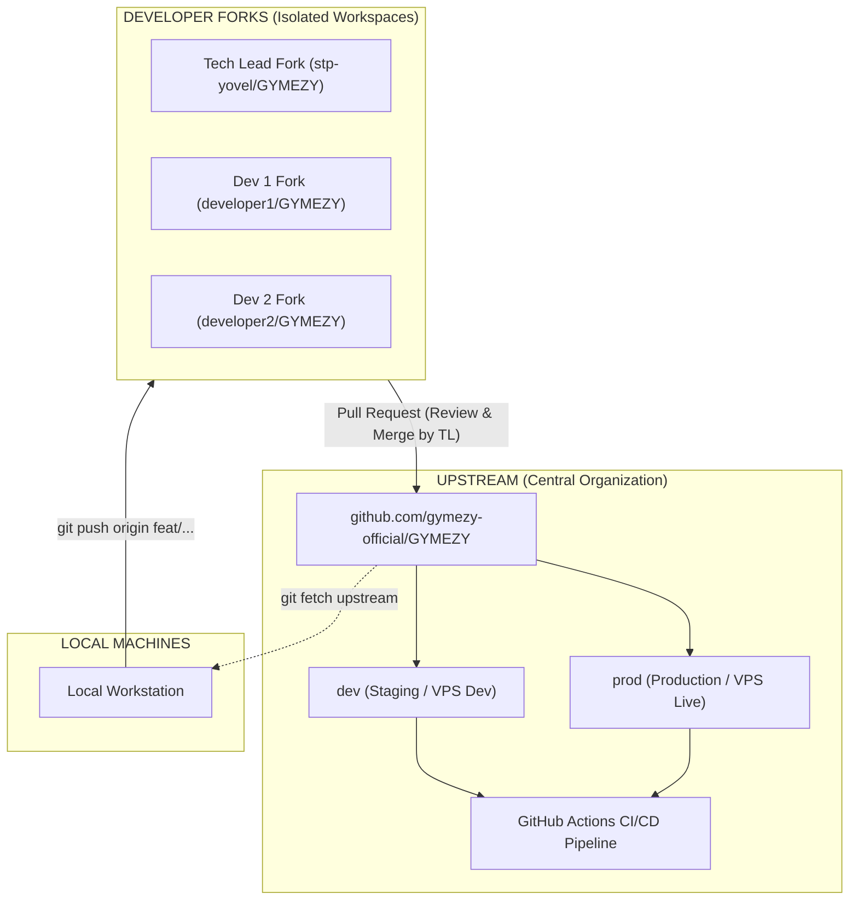

# GYMEZY Team Git Forking & PR Review Workflow

This document outlines the official **Forking & Pull Request (PR)** workflow for the GYMEZY engineering team. This workflow ensures code quality, centralized Tech Lead (TL) review, safe deployment gating, and conflict-free multi-developer collaboration.

---

## 1. Architectural Topology



---

## 2. Remote Configuration Standard

Every developer’s local repository tracks two remotes:

| Remote Name | Repository URL | Purpose |
| :--- | :--- | :--- |
| **`origin`** | `https://github.com/<developer-username>/GYMEZY.git` | Your personal fork (read/write) |
| **`upstream`** | `https://github.com/gymezy-official/GYMEZY.git` | Central organization repository (read-only) |

---

## 3. Developer One-Time Machine Setup

When a new developer joins the GYMEZY team:

```bash
# 1. Fork gymezy-official/GYMEZY on GitHub to personal account

# 2. Clone the personal fork locally
git clone https://github.com/<YOUR_GITHUB_USERNAME>/GYMEZY.git
cd GYMEZY

# 3. Add the official upstream remote
git remote add upstream https://github.com/gymezy-official/GYMEZY.git

# 4. Verify remotes
git remote -v
# Output should show:
# origin   https://github.com/<YOUR_USERNAME>/GYMEZY.git (fetch & push)
# upstream https://github.com/gymezy-official/GYMEZY.git (fetch & push)
```

---

## 4. Daily Feature Development Cycle

### Step 1: Sync Local Branch with Upstream
Before starting any new feature or bug fix:
```bash
git checkout dev
git fetch upstream
git merge upstream/dev
```

### Step 2: Create a Dedicated Feature Branch
Branch names must follow Conventional Commits: `<type>/<short-description>`:
```bash
git checkout -b feat/wallet-split-payment
# or
git checkout -b fix/booking-qr-timeout
```

### Step 3: Implement, Test & Commit
Follow Conventional Commits:
```bash
# Verify unit tests pass
node --test middleware/test/*.test.js

# Stage and commit
git add .
git commit -m "feat(wallet): implement partial wallet offset during membership purchase"
```

### Step 4: Push to Personal Fork (`origin`)
```bash
git push -u origin feat/wallet-split-payment
```

### Step 5: Open a Pull Request to `upstream`
1. Go to [**github.com/gymezy-official/GYMEZY**](https://github.com/gymezy-official/GYMEZY).
2. Click **Contribute** → **Open pull request**.
3. Set base repository: **`gymezy-official/GYMEZY`** &nbsp;|&nbsp; Base branch: **`dev`**.
4. Set head repository: **`<your-username>/GYMEZY`** &nbsp;|&nbsp; Compare branch: **`feat/wallet-split-payment`**.
5. Add a clear description and submit for Tech Lead review.

---

## 5. Tech Lead (TL) Code Review & Deployment Gate

As the Tech Lead (`stp-yovel`):

1. **Review Diff:** Check the Pull Request files, test coverage, and security validations.
2. **Request Changes / Approve:** Add inline comments or approve the PR.
3. **Merge Pull Request:** 
   * Use **Squash and merge** or **Create a merge commit** into `gymezy-official/GYMEZY:dev`.
4. **Automated CI/CD:**
   * Merging into `dev` triggers `.github/workflows/deploy.yml` on `gymezy-official/GYMEZY`.
   * The pipeline securely SSHs into the VPS (`187.127.149.165`) and runs `/var/www/gymezy/deploy-dev.sh`.

---

## 6. Promoting Dev to Production (`prod`)

When features in `dev` are verified and ready for live release:

```bash
# 1. Fetch latest upstream state
git fetch upstream

# 2. Checkout prod branch
git checkout prod
git merge upstream/prod

# 3. Merge verified dev into prod
git merge upstream/dev

# 4. Push to upstream prod (triggers production VPS deployment)
git push upstream prod
```
The GitHub Action will automatically execute `/var/www/gymezy/deploy-prod.sh`.

