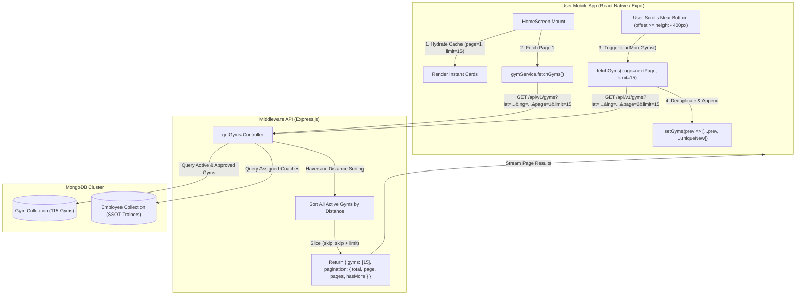

# GYMEZY Gym Discovery, Infinite Scrolling & Geospatial Seeding Specification

This document details the architecture, data contracts, pagination lifecycle, and automated seeding engine for gym discovery across the GYMEZY platform.

---

## 1. System Architecture Overview

The GYMEZY Gym Discovery pipeline allows users to find, filter, and explore fitness centers and trainers within their vicinity. To support large datasets (100+ facilities in metropolitan clusters like Chennai), the platform uses **distance-sorted server-side pagination with client-side infinite scrolling**.



---

## 2. Server-Side Pagination & Proximity Engine

Located at: [`middleware/src/controllers/gym.controller.js`](../middleware/src/controllers/gym.controller.js)

### 2.1 Request Parameters

| Parameter | Type | Default | Description |
|---|---|---|---|
| `lat` / `latitude` | `Number` | — | User current GPS latitude. |
| `lng` / `longitude` | `Number` | — | User current GPS longitude. |
| `page` | `Number` | `1` | Target page index (1-based). |
| `limit` | `Number` | `15` | Batch size per page (clamped between 1 and 100). |
| `search` | `String` | `""` | Search keyword across name, owner, city, area, tags, workouts, facilities. |
| `category` | `String` | `""` | Workout category filter (`Strength`, `HIIT`, `Yoga`, `Zumba`, `CrossFit`, etc.). |
| `type` / `genderAllowed` | `String` | `""` | Gender admission filter (`Unisex`, `Women Only`, `Men Only`). |
| `facility` | `String` | `""` | Specific amenities (`AC Gym`, `Steam Room`, `Parking`, etc.). |
| `sortBy` | `String` | `'nearest'` | Sorting criteria (`nearest`, `rating`, `price_low`, `price_high`). |

### 2.2 Proximity Calculation (Haversine Formula)

For every query, the controller evaluates the true physical distance between the user's GPS coordinates and each gym's GeoJSON point `location.coordinates: [lng, lat]`:

$$\text{distance} = 2 R \cdot \arcsin\left(\sqrt{\sin^2\left(\frac{\Delta \text{lat}}{2}\right) + \cos(\text{lat}_1) \cos(\text{lat}_2) \sin^2\left(\frac{\Delta \text{lng}}{2}\right)}\right)$$

The facilities are sorted with nearest locations first, and sliced:

```javascript
const pageNum = Math.max(1, Number.parseInt(page, 10) || 1);
const limitNum = Math.min(100, Math.max(1, Number.parseInt(limit, 10) || 15));
const skip = (pageNum - 1) * limitNum;

// Slice distance-sorted array
const paginatedGyms = processedGyms.slice(skip, skip + limitNum);
```

### 2.3 Response Payload Contract

```json
{
  "success": true,
  "message": "Gyms retrieved successfully",
  "data": {
    "gyms": [
      {
        "id": "GYM18",
        "_id": "6729a1b2c3d4e5f607182901",
        "partnerId": "GYM18",
        "name": "FitZone Luxury Club - Anna Nagar",
        "area": "Anna Nagar",
        "city": "Chennai",
        "pincode": "600040",
        "distance": 0.45,
        "distanceText": "0.45 km",
        "rating": 4.9,
        "reviewsCount": 182,
        "singleSessionPrice": 199,
        "monthlyPrice": 1999,
        "facilities": ["AC Gym", "Locker Facility", "Shower Available", "Steam Room", "Parking Available"],
        "coverPhoto": "https://images.unsplash.com/photo-1540497077202-7c8a3999166f?q=80&w=800"
      }
    ],
    "pagination": {
      "total": 115,
      "page": 1,
      "limit": 15,
      "pages": 8,
      "hasMore": true
    }
  }
}
```

---

## 3. Client-Side Infinite Scrolling Implementation

Located at: [`mobile-application/user-react/src/pages/HomeScreen.js`](../mobile-application/user-react/src/pages/HomeScreen.js)

### 3.1 State Architecture

```javascript
const PAGE_SIZE = 15;

const [gyms, setGyms] = useState(() => initialCachedGyms);
const [isLoadingGyms, setIsLoadingGyms] = useState(false);
const [gymsPage, setGymsPage] = useState(1);
const [hasMoreGyms, setHasMoreGyms] = useState(true);
const [totalGymsCount, setTotalGymsCount] = useState(0);
const [isLoadingMoreGyms, setIsLoadingMoreGyms] = useState(false);

const gymsPageRef = React.useRef(1);
gymsPageRef.current = gymsPage;
```

### 3.2 Scroll Detection & Trigger Boundary

The top-level `<ScrollView>` listens to scroll events with a throttle rate of 16ms:

```javascript
const handleHomeScroll = (event) => {
  const { layoutMeasurement, contentOffset, contentSize } = event.nativeEvent;
  const paddingToBottom = 400; // Trigger threshold before the user hits the absolute bottom
  const isCloseToBottom = layoutMeasurement.height + contentOffset.y >= contentSize.height - paddingToBottom;

  if (isCloseToBottom && hasMoreGyms && !isLoadingMoreGyms && !isLoadingGyms) {
    loadMoreGyms();
  }
};
```

### 3.3 Safe Deduplicated Appending (`loadMoreGyms`)

To prevent duplicate keys or race conditions when fast-scrolling:

```javascript
const loadMoreGyms = async () => {
  if (isLoadingMoreGyms || isLoadingGyms || !hasMoreGyms) return;

  setIsLoadingMoreGyms(true);
  const nextPage = gymsPageRef.current + 1;

  try {
    const res = await gymService.fetchGyms({
      lat: userLocation.latitude,
      lng: userLocation.longitude,
      category: selectedCategory,
      search: searchQuery,
      type: selectedType,
      facility: selectedFacility,
      workout: selectedWorkout,
      page: nextPage,
      limit: PAGE_SIZE,
    });

    const newGyms = res?.gyms || [];
    if (newGyms.length > 0) {
      setGyms((prev) => {
        const existingIds = new Set(prev.map((g) => (g.id || g._id || g.partnerId)?.toString()));
        const uniqueNew = newGyms.filter((g) => !existingIds.has((g.id || g._id || g.partnerId)?.toString()));
        return [...prev, ...uniqueNew];
      });
      setGymsPage(nextPage);
      gymsPageRef.current = nextPage;
    }

    const total = res?.pagination?.total ?? totalGymsCount;
    setTotalGymsCount(total);
    const more = res?.pagination?.hasMore ?? (res?.pagination?.page < res?.pagination?.pages);
    setHasMoreGyms(Boolean(more && newGyms.length > 0));
  } catch (err) {
    console.warn('[HOME] Failed to load more gyms:', err.message);
  } finally {
    setIsLoadingMoreGyms(false);
  }
};
```

### 3.4 Feed Footer Status Indicators

```jsx
{/* Active Page Loading Spinner */}
{isLoadingMoreGyms && (
  <View style={styles.loadingMoreContainer}>
    <ActivityIndicator size="small" color={AppColors.primaryColor} />
    <Text style={[styles.loadingMoreText, { color: colors.subtitle }]}>
      Loading more gyms near {userLocation.name}...
    </Text>
  </View>
)}

{/* End of Dataset Boundary Notice */}
{!hasMoreGyms && filteredGyms.length > 0 && !isLoadingGyms && (
  <View style={styles.endOfListContainer}>
    <View style={[styles.endOfListDivider, { backgroundColor: colors.border }]} />
    <Text style={[styles.endOfListText, { color: colors.subtitle }]}>
      You've explored all {totalGymsCount || filteredGyms.length} gyms near you
    </Text>
    <View style={[styles.endOfListDivider, { backgroundColor: colors.border }]} />
  </View>
)}
```

---

## 4. 100 Chennai Localities Geospatial Seeding Engine

Located at: [`middleware/src/scripts/seed100ChennaiGyms.js`](../middleware/src/scripts/seed100ChennaiGyms.js)

### 4.1 Geographic Distribution (100 Chennai Neighborhoods)

The script populates **100 authentic gym centers** across all key geographic zones:

1. **Central Chennai (15 Areas):** Anna Nagar (600040), T. Nagar (600017), Nungambakkam (600034), Alwarpet (600018), Mylapore (600004), Kilpauk (600010), Chetpet (600031), Shenoy Nagar (600030), Egmore (600008), Royapettah (600014), Gopalapuram (600086), Triplicane (600005), Teynampet (600018), Nandanam (600035), Choolaimedu (600094).
2. **South Chennai Urban (15 Areas):** Adyar (600020), Besant Nagar (600090), Thiruvanmiyur (600041), R.A. Puram (600028), Mandaveli (600028), Kotturpuram (600085), Saidapet (600015), Guindy (600032), Velachery (600042), Madipakkam (600091), Keelkattalai (600117), Pallikaranai (600100), Medavakkam (600100), Kovilambakkam (600129), Nanmangalam (600129).
3. **OMR IT Highway (10 Areas):** Taramani (600113), Kandanchavadi (600096), Perungudi (600096), Thoraipakkam (600097), Karapakkam (600097), Sholinganallur (600119), Semmancheri (600119), Navalur (603103), Siruseri (603103), Kelambakkam (603103).
4. **ECR Coastline (10 Areas):** Kottivakkam (600041), Palavakkam (600041), Neelankarai (600115), Injambakkam (600115), Akkarai (600119), Panaiyur (600119), Uthandi (600119), Kanathur (603112), Muttukadu (603112), Kovalam (603112).
5. **West Chennai Commercial Corridor (20 Areas):** Vadapalani (600026), Ashok Nagar (600083), K.K. Nagar (600078), Virugambakkam (600092), Saligramam (600093), Valasaravakkam (600087), Ramapuram (600089), Porur (600116), Iyyappanthangal (600056), Mangadu (600122), Poonamallee (600056), Kumananchavadi (600056), Manapakkam (600125), Nandambakkam (600089), Gerugambakkam (600128), Kundrathur (600069), Thirumazhisai (600124), Karambakkam (600116), Mugalivakkam (600125), Alapakkam (600116).
6. **North & Industrial Suburbs (20 Areas):** Mogappair East (600037), Mogappair West (600037), Nolambur (600095), Ambattur (600053), Ambattur Estate (600058), Padi (600050), Korattur (600080), Villivakkam (600049), Kolathur (600099), Perambur (600011), Avadi (600054), Pattabiram (600072), Thirumullaivoyal (600062), Madhavaram (600060), Red Hills (600052), Puzhal (600066), Vyasarpadi (600039), Sowcarpet (600079), George Town (600001), Royapuram (600013).
7. **GST Highway & Tambaram Suburbs (10 Areas):** Pallavaram (600043), Chromepet (600044), Hasthinapuram (600064), Chitlapakkam (600064), Sembakkam (600073), Selaiyur (600073), East Tambaram (600059), West Tambaram (600045), Perungalathur (600063), Vandalur (600048), Urapakkam (603210), Guduvanchery (603202), Potheri (603203).

### 4.2 Single Source of Truth (SSOT) Trainer Generation

For every seeded gym, certified coaches are written directly to the `Employee` model:

```javascript
await Employee.create({
  gymId: createdGym._id,
  gymPartnerId: createdGym.partnerId,
  gymName: createdGym.name,
  employeeId: `TR${String(seq).padStart(3, '0')}`,
  name: trainerName,
  role: 'Trainer',
  avatar: trainerAvatarUrl,
  specialty: trainerSpecialty,
  experienceYears: 5,
  rating: 4.9,
  status: 'Active',
  attendance: 'Present',
  approvalStatus: 'Approved',
  type: 'Full-Time',
  accessType: 'Employee',
});
```

### 4.3 Running the Seeder

```bash
# Execute 100 Chennai Gym Seeder directly
npm run seed:100 --prefix middleware

# Or execute full master seeder
npm run seed:gyms --prefix middleware
```

---

## 5. Group Classes UI Redesign & Direct Batch Routing

Located at: [`mobile-application/user-react/src/pages/BookingSessionScreen.js`](../mobile-application/user-react/src/pages/BookingSessionScreen.js)

### 5.1 Route Differentiation

- **General Gym Access Passes**: Uses `SessionBookingFlow` for open-floor day passes, weekly passes, and custom dates with personal coach add-ons.
- **Group Classes & Batches**: Trainer-led scheduled cohorts with predetermined dates, times, and cohort limits. Selecting **Group Classes** routes directly to `currentView: 'group_classes'`.

### 5.2 Component Status Hierarchy Redesign

| State | Component | Styling Token |
|---|---|---|
| **User Enrolled** | `enrolledUserBadge` | Mint background (`#ECFDF5`), Emerald border (`#A7F3D0`), `check-circle` icon, `#059669` text. |
| **Available Seats** | `sectionCapacityPill` | Neutral slate background (`#F1F5F9`), slate text (`#475569`), `people-outline` icon. Shows `X/Y Seats`. |
| **Limited Spots** | `sectionCapacityPill` | Amber background (`#FFFBEB`), Amber border (`#FDE68A`), text `Only X left`. |
| **Batch Full** | `sectionCapacityPill` | Red background (`#FEF2F2`), Red border (`#FECACA`), `block` icon, text `Slot Full`. |
| **Enrolled CTA** | `viewDetailsBtn` | Emerald background (`#ECFDF5`), text `Enrolled • View Pass`, ticket icon (`confirmation-number`). |

---

## 6. Industry-Standard Fuzzy Search Engine with Typo Tolerance

Located at:
- Core Engine: [`middleware/src/utils/fuzzySearchEngine.js`](../middleware/src/utils/fuzzySearchEngine.js)
- Search Helper SSOT: [`middleware/src/utils/searchHelper.js`](../middleware/src/utils/searchHelper.js)
- API Controller: [`middleware/src/controllers/gym.controller.js`](../middleware/src/controllers/gym.controller.js)
- Client Integration: [`mobile-application/user-react/src/pages/HomeScreen.js`](../mobile-application/user-react/src/pages/HomeScreen.js)

### 6.1 Algorithmic Design (Damerau-Levenshtein Matrix)

Traditional search engines using substring regex fail when users mistype queries. GYMEZY implements a high-performance **Damerau-Levenshtein distance matrix** supporting insertions, deletions, substitutions, and character transpositions.

Typo tolerance is bounded dynamically by token length to eliminate false positives:
- **1 – 2 Characters:** Exact match only (`distance === 0`).
- **3 – 6 Characters:** Maximum allowed edit distance of `1` (e.g. `"ana"` $\to$ `"anna"`, `"fitnes"` $\to$ `"fitness"`, `"ygoa"` $\to$ `"yoga"`).
- **7+ Characters:** Maximum allowed edit distance of `2` (e.g. `"crosfit"` $\to$ `"crossfit"`, `"velachry"` $\to$ `"velachery"`, `"nungambakam"` $\to$ `"nungambakkam"`).

### 6.2 Multi-Field Weighted Scoring Hierarchy

Matching query tokens against candidate gyms computes a weighted relevance score:

$$\text{Relevance} = \sum_{\text{token} \in \text{query}} \max\left( W_{\text{field}} \cdot \left(1 - \frac{\text{edit\_dist}}{\max(\text{len}_1, \text{len}_2)}\right) \right)$$

| Field | Weight | Description |
|---|---|---|
| `partnerId` | **12x** | Direct partner ID matches (e.g. `"GYM18"`). |
| `name` | **10x** | Facility brand or gym name. |
| `phone` / `email` | **10x** | Contact phone digits ($\ge 4$ chars) or email address. |
| `area` | **8x** | Chennai neighborhood/locality. |
| `city` | **7x** | City name (e.g. `"Chennai"`). |
| `workouts` | **6x** | Activity tags (`CrossFit`, `HIIT`, `Yoga`, `Zumba`, `Boxing`). |
| `facilities` / `amenities` | **4x** | Amenities (`AC Gym`, `Steam Room`, `Locker`, `Parking`). |
| `tags` | **4x** | Operational tags (`Unisex`, `Luxury`, `Top Rated`). |
| `ownerName` / `address` | **2x** | Owner full name or street address. |

For multi-token queries (e.g. `"Anna Nagar luxury"`), a coverage multiplier boosts documents matching multiple query tokens.

### 6.3 Hybrid Relevance & Proximity Ranking

When search is active without an explicit sort order override, GYMEZY applies hybrid sorting:
1. **Primary Sort:** Relevance Score (highest first).
2. **Secondary Tie-Breaker:** Nearest GPS Distance (closest first).

### 6.4 "Did You Mean" Spelling Corrections & Interactive Chip

The engine maintains a canonical vocabulary of all 100 Chennai localities and standard fitness terminology. When misspellings are detected, the API returns a formatted `didYouMean` correction (e.g. `"ana nagar"` $\to$ `"Anna Nagar"`, `"crosfit"` $\to$ `"CrossFit"`, `"fitnes"` $\to$ `"Fitness"`).

In `HomeScreen.js`, an interactive pill appears below the search input:
`💡 Did you mean [Suggested Term]? Tap to search`
Tapping the chip instantly replaces the search query with the suggested correction.

### 6.5 Super Admin Fleet Management Integration (Numbered Pagination)

The exact same multi-field fuzzy search and Damerau-Levenshtein engine powers the Super Admin Gyms Directory ([`GymsManagement.jsx`](../web-application/super-admin/src/admin/GymsManagement.jsx)), backed by `GET /api/v1/gyms/admin/fleet`:
- **Server-Side Filtering**: `tab` (`approved`, `pending`, `on_hold`, `rejected`), `status`, `subscriptionType`, `location`, `phone`, and `search`.
- **Typo-Tolerant Ranking**: Multi-field weighted scoring matches gym names, partner IDs, phone numbers, owners, and localities even with typos.
- **"Did You Mean" Suggestion Banner**: If a typo is detected, a clickable banner appears above the table to search the corrected term with a single click.
- **Traditional Numbered Pagination**: Paginated with `page` and `limit` (default: 10), complete with `pageSize` changer (10, 20, 50, 100) and page bounds indicators without infinite scrolling.
- **Global Lifecycle Counters**: Returns exact real-time badge counts (`approved`, `pending`, `on_hold`, `rejected`, `total`) alongside the current page slice.

---

## 7. Verification and Audit

All backend unit tests continuously validate query isolation, distance sorting, fuzzy typo tolerance, and search regex safety:

```bash
node --test middleware/test/*.test.js
```
- Total Passing Suites: **20**
- Total Passing Tests: **126**
- Regression Errors: **0**

