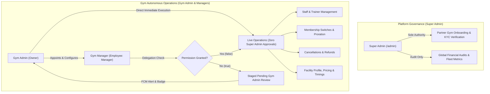
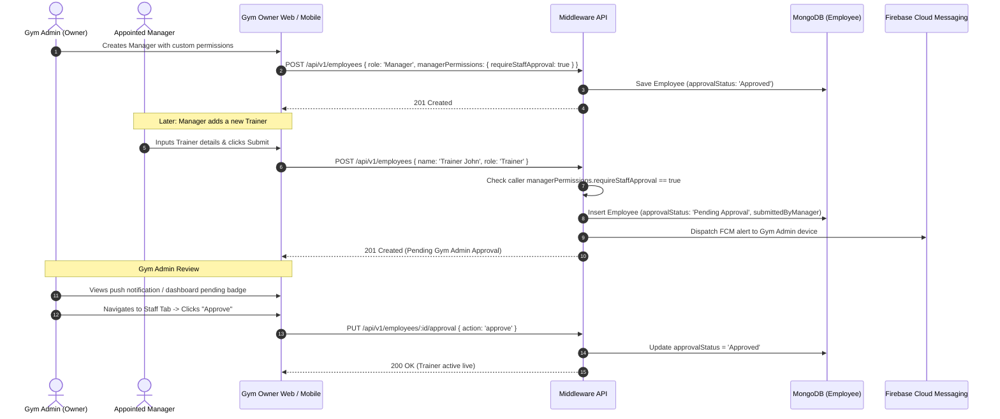
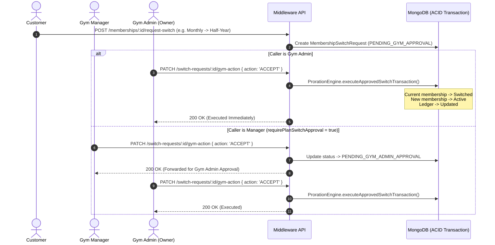

# GYMEZY Gym Manager vs. Gym Admin Delegation Architecture

> **Document Version:** 1.0.0  
> **Last Updated:** November 2026  
> **Target Audience:** Frontend Engineers, Mobile Engineers, Backend API Engineers, QA & Security Architects  
> **Affected Repositories:**  
> - `middleware` (Node.js / Express / Mongoose)  
> - `web-application/gym-owner` (React / Ant Design / Vite)  
> - `web-application/super-admin` (React / Ant Design / Vite)  
> - `mobile-application/gym-owner` (React Native / CLI)  

---

## 1. Architectural Overview & Boundary Definitions

To ensure high-throughput gym operations without operational bottlenecks, the GYMEZY platform strictly decouples **Fleet Governance** from **Daily Gym Operations**:



### Key Policy Mandates:
1. **Super Admin Isolation:** Super Admin verification exists **strictly and solely** for initial partner gym onboarding (`/admin/gyms` KYC verification). Super Admin approval has been completely removed from staff additions, staff updates, membership switches, proration calculations, membership cancellations, and gym profile edits.
2. **Gym Admin Direct Authority:** When a Gym Admin (Owner) modifies staff, updates profile timings, or accepts a membership switch, the database transaction applies **immediately and directly** (`approvalStatus: 'Approved'`).
3. **Manager Role Delegation:** When creating or editing an employee with `role: 'Manager'`, the Gym Admin can toggle 4 granular permissions. By default, all 4 toggles require Admin approval (`true`) until explicitly unticked by the Admin.

---

## 2. Granular Delegation Permission Matrix

Each `Employee` document with `role: 'Manager'` embeds a `managerPermissions` subdocument:

| Permission Field | Default | Scope & Description | When `false` (Direct Execution) | When `true` (Admin Approval Required) |
|---|---|---|---|---|
| `requireStaffApproval` | `true` | Creating, updating, or deactivating trainers, housekeeping, and front-desk staff. | Staff added/edited live with `approvalStatus = 'Approved'`. | Created with `approvalStatus = 'Pending Approval'` and staged under `submittedByManager`. |
| `requirePlanSwitchApproval` | `true` | Approving member requests to switch or upgrade membership tiers with pro-rated billing. | Triggers atomic ACID switch transaction immediately. | Switches to `PENDING_GYM_ADMIN_APPROVAL`. |
| `requireCancellationApproval` | `true` | Approving membership cancellations and refund settlements. | Cancels membership directly and updates wallet/gateway ledger. | Transitions to `PENDING_GYM_ADMIN_APPROVAL`. |
| `requireProfileEditApproval` | `true` | Modifying gym facilities, timings, descriptions, day-pass rates, or policies. | Updates live gym document immediately. | Staged in `gym.pendingManagerEdits` with visual diff tracking. |

### 2.1 Financial & Revenue Privacy Isolation (Manager Console)
To maintain commercial privacy, **all financial and revenue metrics are strictly partitioned** away from employees assigned the `MANAGER` role:
1. **Live Dashboard Overview:** The 3 primary revenue cards (**Total Revenue / Monthly GMV**, **Membership Plans Revenue**, and **Session Bookings Revenue**) are hidden when `isManager` is active. The Manager view renders exclusively the 3 operational volume cards (**App Count**, **Total Active Users**, and **Walk-in Count**) in a balanced 3-column row.
2. **Sidebar Navigation (`AppSidebar`):** The **Transactions & Payments** (`/owner/transactions`) navigation link is excluded from the Manager menu hierarchy.
3. **Route Guard & Security:** Direct URL navigation to `/owner/transactions` renders an explicit `Result status="403"` restricted access screen and stops transaction API querying.
4. **Gym Profile Summary:** The Monthly Revenue metric under Gym Profile is omitted for Managers.

---

## 3. Database Schema Specifications

### 3.1 Employee Model (`middleware/src/models/employee.model.js`)
```javascript
const employeeSchema = new mongoose.Schema({
  gymId: { type: mongoose.Schema.Types.Mixed, required: true, index: true },
  gymPartnerId: { type: String, trim: true, required: true, index: true },
  name: { type: String, required: true, trim: true },
  role: { type: String, required: true, trim: true, default: 'Trainer' },
  approvalStatus: {
    type: String,
    enum: ['Pending Approval', 'Approved', 'Rejected'],
    default: 'Approved', // Defaults to Approved for Owner additions
  },
  managerPermissions: {
    requireStaffApproval: { type: Boolean, default: true },
    requirePlanSwitchApproval: { type: Boolean, default: true },
    requireCancellationApproval: { type: Boolean, default: true },
    requireProfileEditApproval: { type: Boolean, default: true },
  },
  submittedByManager: {
    managerId: { type: mongoose.Schema.Types.ObjectId, ref: 'Employee' },
    managerName: { type: String, trim: true },
    submittedAt: { type: Date },
  },
  adminRemarks: { type: String, trim: true },
  // ...other fields (documents, compensation, schedule, etc.)
});
```

### 3.2 Gym Model (`middleware/src/models/gym.model.js`)
```javascript
const gymSchema = new mongoose.Schema({
  // ...core fields
  pendingManagerEdits: {
    submittedBy: { type: mongoose.Schema.Types.ObjectId, ref: 'User' },
    submittedByName: { type: String, trim: true },
    submittedAt: { type: Date },
    edits: { type: mongoose.Schema.Types.Mixed },
    status: {
      type: String,
      enum: ['PENDING', 'APPROVED', 'REJECTED'],
      default: 'PENDING',
    },
    adminRemarks: { type: String, trim: true },
  },
});
```

---

## 4. End-to-End Execution Sequence Diagrams

### 4.1 Staff Creation & Approval Sequence


### 4.2 Membership Switch & Proration Execution Sequence


---

## 5. Multi-Channel Alerting Architecture

When a Manager performs an action requiring Gym Admin approval, GYMEZY alerts the Gym Admin across 4 real-time touchpoints:
1. **Push Notification (FCM):** Sent to the Gym Admin's mobile device via Firebase Admin SDK (`services/notification.service.js`) with high-priority channel tags (`GYM_OPERATIONAL_ALERTS`).
2. **Dashboard Counter Badge:** The Gym Owner Web and Mobile dashboards query `/employees/approvals` and `/memberships/gym/:id/switch-requests?status=PENDING_GYM_ADMIN_APPROVAL` to render real-time numeric badges.
3. **In-App Toast:** Alerts the Manager immediately upon form submission that the item has been staged for Gym Admin sign-off.
4. **Inline Review Cards:** In the Employees Table, Members List, and Profile Screens, pending items display dedicated `Approve` (green) and `Reject` (red) buttons directly for the Gym Admin.

---

## 6. API Reference

### 6.1 Employee Management
- `POST /api/v1/employees`: Creates employee. Applies directly if caller is Gym Admin or Manager with permission; stages as `Pending Approval` if Manager requires approval.
- `PUT /api/v1/employees/:id`: Updates employee. Checked against `requireStaffApproval`.
- `PUT /api/v1/employees/:id/approval`: Reviews pending employee. Authorized for `GYM_OWNER` and `SUPER_ADMIN`.
  - Body: `{ action: 'approve' | 'reject', rejectionReason: string }`

### 6.2 Membership Switches & Cancellations
- `PATCH /api/v1/memberships/switch-requests/:id/gym-action`:
  - Body: `{ action: 'ACCEPT' | 'REJECT', remarks: string }`
  - When called by Gym Admin: Executes ACID switch transaction directly.
  - When called by Manager: Checked against `requirePlanSwitchApproval`.
- `PATCH /api/v1/memberships/:id/cancel/accept`:
  - Body: `{ refundAmountPaise: number, remarks: string }`
  - Checked against `requireCancellationApproval`.

### 6.3 Gym Profile & Timings
- `PUT /api/v1/gyms/:id`:
  - When called by Gym Admin: Applied directly to live gym document.
  - When called by Manager without permission: Staged in `gym.pendingManagerEdits`.

### 6.4 Scoped Dashboard Statistics & Temporal Filtering
- `GET /api/v1/gyms/:id/dashboard-stats`:
  - Query parameters:
    - `range`: `'Today'` | `'Yesterday'` | `'This Week'` | `'This Month'` | `'All Time'` | `'custom'`
    - `startDate` & `endDate`: ISO timestamp strings for custom range boundaries.
  - Dynamically partitions all revenue (Member Plans & Session Bookings), volume counts (App Count, Walk-in Count, Total Active Customers), and recent activity within the requested temporal boundaries.

### 6.5 Super Admin Command Center Statistics & Fleet Temporal Filtering
- `GET /api/v1/admin/dashboard-stats`:
  - Query parameters:
    - `filterType` / `range`: `'today'` | `'yesterday'` | `'week'` | `'month'` | `'all'` | `'custom'`
    - `startDate` & `endDate`: ISO timestamp strings for custom range boundaries.
  - Dynamically computes platform-wide metrics across all gyms:
    - `totalGmv`: Platform Gross Merchandise Volume (Session Bookings + Membership Plans, excluding failed/refunded payments and cancellations) across the selected temporal window.
    - `completedWorkouts`: Total completed workouts fulfilled across the fleet within the window.
    - `completionRate`: Fulfillment percentage (`(completed / total) * 100`).
    - `bookings`: Status partition (`total`, `confirmed`, `completed`, `cancelled`, `noShow`).
    - `dateFilter`: Active temporal metadata (`label`, `range`, `startDate`, `endDate`).
    - `revenueMonthly`: 6-month historical monthly breakdown of subscription vs commission revenue.

---

## 7. Verification & Test Coverage

All delegation and scoped analytics rules are verified under automated unit tests in `middleware/test/`:
- ✅ Schema validation for default 4 boolean toggles (`true`).
- ✅ Schema support for customizable permissions on Manager creation.
- ✅ Schema support for `pendingManagerEdits` in Gym model.
- ✅ State validation for `PENDING_GYM_ADMIN_APPROVAL` in Membership Switch requests.
- ✅ State validation for `PENDING_GYM_ADMIN_APPROVAL` in Membership Cancellation requests.
- ✅ Date range filtering SSOT (`searchHelper.parseDateRangeFilter`) covering Today, Yesterday, This Week, This Month, and Custom Ranges across both Gym Owner (`range`) and Super Admin (`filterType`).
- ✅ Super Admin Command Center temporal aggregation tests (`admin_dashboard.test.js`).
- **Run command:** `node --test middleware/test/*.test.js` (121/121 passing).

