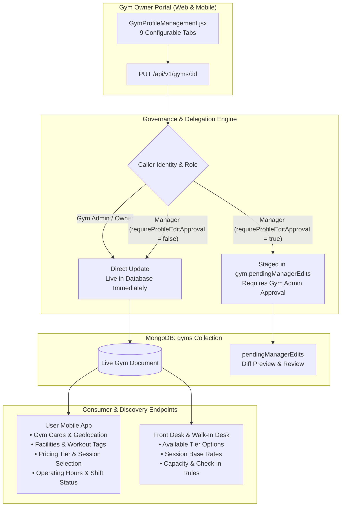
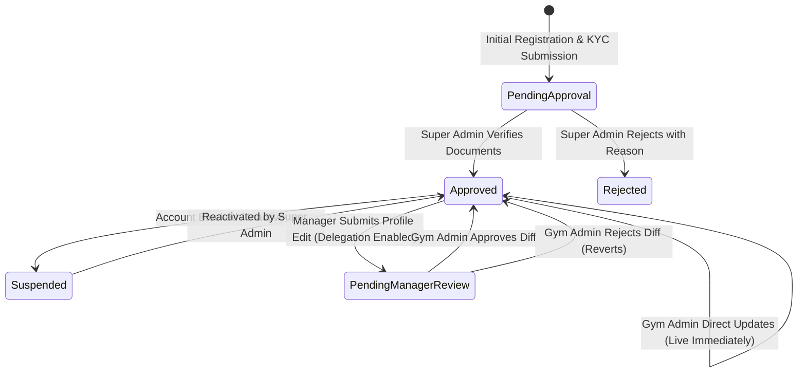

# GYMEZY Gym Profile Management & Configuration Specification

This document details the complete data architecture, lifecycle states, permission governance, and cross-platform integrations for **Gym Profile Management** across the GYMEZY platform.

---

## 1. System Architecture Overview

The Gym Profile is the core multi-tenant entity representing a partner gym facility. It governs customer-facing discovery, pricing catalogs, operational schedules, KYC compliance, and settlement banking.



---

## 2. Gym Profile Data Architecture (`gym.model.js`)

The `Gym` Mongoose model encapsulates 9 specialized operational sub-schemas:

### 2.1 Basic Business Details & KYC
| Field | Type | Description |
| :--- | :--- | :--- |
| `name` | String (Required) | Commercial brand / trading name of the facility. |
| `partnerId` | String (Unique) | Sequential partner ID (e.g., `GYM1`, `GYM4`, `GYM-TN-001`). |
| `ownerName` | String | Legal name of the gym owner / representative. |
| `ownerEmail` | String | Official registered email address. |
| `ownerPhone` | String | Contact phone number for administrative alerts. |
| `businessType` | Enum | `Sole Proprietorship`, `Partnership`, `Private Limited`, `LLP`, `Other`. |
| `gstNumber` | String | 15-character Goods and Services Tax Identification Number. |
| `panNumber` | String | 10-character Permanent Account Number. |
| `yearEstablished`| Number | Year operations commenced. |
| `floorSpaceSqFt` | Number | Total workout floor area in square feet. |
| `maxFloorCapacity`| Number | Maximum concurrent occupant safety threshold. |
| `genderAllowed` | Enum | `Unisex`, `Male Only`, `Female Only`. |
| `aboutText` | String | Rich descriptive summary presented on user mobile app discovery cards. |

### 2.2 Location & Geolocation Coordinates
| Field | Type | Description |
| :--- | :--- | :--- |
| `address` | String (Required) | Physical building address and street name. |
| `area` | String | Locality / neighborhood (e.g., Porur, Anna Nagar). |
| `city` | String (Required) | Municipality / City (e.g., Chennai). |
| `state` | String (Required) | State / Union Territory (e.g., Tamil Nadu). |
| `pincode` | String (Required) | 6-digit postal code. |
| `landmark` | String | Notable nearby geographical landmark. |
| `location` | GeoJSON Point | `{ type: 'Point', coordinates: [longitude, latitude] }` with 2dsphere indexing for radius-based nearby gym searches. |
| `googleMapsUrl` | String | Direct external navigation link for member directions. |

### 2.3 Operating Hours & Weekly Schedule (`openingHoursSchema`)
The schedule engine supports four distinct scheduling modes:
* `REGULAR`: Fixed standard weekday / weekend open and close times (e.g., `05:30 AM` – `10:30 PM`).
* `SPLIT_SHIFT`: Separate morning window (`05:30 AM` – `11:30 AM`) and evening window (`04:30 PM` – `10:30 PM`).
* `24_HOURS`: Continuous round-the-clock facility access.
* `Holidays & Exception Calendar`: Array of date-specific override rules (`holidays: [{ date, title, type: 'Closed' | 'Special Hours', hours, notes }]`).

### 2.4 Pricing Plans & Pass Configuration
* **Standard Membership Tiers**:
  * `monthly`: 30-day access base price.
  * `quarterly`: 90-day access base price.
  * `halfYearly`: 180-day access base price.
  * `annual`: 365-day access base price.
* **Custom Pricing Plans (`customPricingPlans`)**: Customizable plan packages with dynamic day counts, feature bullet points, and assigned trainer options.
* **Single-Session & Day Passes**:
  * `singleSessionPrice`: Pay-as-you-go general workout fee (default ₹199 - ₹250).
  * `dayPassPrice`: Single-day unlimited facility access pass.

### 2.5 Facilities, Amenities & Workout Tags
* `facilities`: Array of facility tags (e.g., `Air Conditioning`, `Steam Room`, `Sauna`, `Locker Rooms`, `Showers`, `Free Wi-Fi`, `Parking`, `Cafeteria`, `Biometric Access`).
* `workoutCategories`: Supported training disciplines (e.g., `Cardio`, `Strength Training`, `CrossFit`, `HIIT`, `Yoga`, `Zumba`, `Boxing / MMA`, `Pilates`).

### 2.6 Gallery & Branding Media
* `logo`: Brand emblem displayed on headers, QR passes, and invoices.
* `coverPhoto`: Wide hero banner displayed at the top of the mobile app gym card.
* `galleryPhotos`: Array of high-resolution facility images (equipment, floor space, amenities).
* Storage: Compressed WebP Data URLs or CDN image paths.

### 2.7 Bank & Settlement Details
* `accountHolderName`: Legal entity or owner account name.
* `accountNumber`: Bank account number.
* `ifscCode`: 11-character Indian Financial System Code.
* `bankName`: Financial institution name.
* `upiId`: Virtual Payment Address for direct payouts.

---

## 3. Gym Profile Lifecycle & Governance States



1. **Initial Onboarding Verification (Super Admin Boundary)**:
   * Super Admin approval exists **strictly and solely** for partner gym onboarding.
   * Endpoints: `GET /api/v1/admin/gyms`, `PATCH /api/v1/admin/gyms/:id/status`.
2. **Routine Operational Profile Management (Gym Admin Autonomous)**:
   * Once approved, Gym Admin edits to hours, pricing, photos, and amenities apply directly to the database without Super Admin review.
   * Endpoint: `PUT /api/v1/gyms/:id`.
3. **Manager Delegation Governance (`pendingManagerEdits`)**:
   * If a Manager edits the profile and `requireProfileEditApproval === true`:
     * Changes are saved into `gym.pendingManagerEdits: { submittedByName, submittedAt, edits: { ... }, status: 'PENDING_ADMIN_APPROVAL' }`.
     * Live customer-facing data remains unchanged until Gym Admin approves via the approvals drawer.

---

## 4. Gym Owner Portal UI Tabs Reference (`GymProfileManagement.jsx`)

The Gym Owner Web portal provides a tabbed interface divided into 9 sections:

| Tab Key | Tab Label | Configurable Options |
| :--- | :--- | :--- |
| `basic` | **Basic Details** | Gym Name, Owner Name, Phone, Email, Business Type, GST, PAN, Address, Floor Space, Capacity, Gender, About Text. |
| `facilities` | **Facilities & Equipment** | Multi-selection checkboxes for facility amenities with icon badges. |
| `workouts` | **Workout Classes & Activities** | Discipline tags with customizable difficulty levels and duration estimates. |
| `pricing` | **Pricing & Passes** | Single Session price, Day Pass price, Tier add-ons, and Custom Multi-Month plans. |
| `images` | **Images & Photos** | Logo uploader, Cover banner uploader, and Drag-and-Drop gallery uploader. |
| `hours` | **Operating Hours** | Mode picker (`REGULAR`, `SPLIT_SHIFT`, `24_HOURS`), time range pickers, and Holiday override rules. |
| `bank` | **Bank Details** | Account number, IFSC, Bank name, UPI ID for settlement processing. |
| `social` | **Social & Web Links** | Instagram handle, Website, WhatsApp business phone, and Google Maps location URL. |
| `settings` | **Settings & Status** | Partner ID, Verification badge status, and Deactivation controls. |

---

## 5. API Contracts

### Update Gym Profile
* **Route**: `PUT /api/v1/gyms/:id`
* **Headers**: `Authorization: Bearer <JWT>`
* **Allowed Roles**: `GYM_OWNER`, `MANAGER`, `SUPER_ADMIN`
* **Request Body (Partial or Full)**:
```json
{
  "name": "Titanium Fitness Club",
  "phone": "+91 9876543210",
  "singleSessionPrice": 249,
  "pricingPlans": {
    "monthly": 1999,
    "quarterly": 4999,
    "halfYearly": 8999,
    "annual": 14999
  },
  "openingHours": {
    "mode": "REGULAR",
    "weekdayOpen": "05:30 AM",
    "weekdayClose": "10:30 PM",
    "weekendOpen": "06:00 AM",
    "weekendClose": "09:00 PM"
  },
  "facilities": ["Air Conditioning", "Locker Rooms", "Showers", "Steam Room"]
}
```

* **Response (200 OK - Direct Update by Admin)**:
```json
{
  "success": true,
  "message": "Gym profile updated successfully.",
  "data": {
    "_id": "672880c134b9d031cba41e99",
    "partnerId": "GYM4",
    "name": "Titanium Fitness Club",
    "approvalStatus": "Approved"
  }
}
```

* **Response (200 OK - Staged Update by Manager)**:
```json
{
  "success": true,
  "message": "Changes submitted successfully! Pending Gym Admin approval.",
  "data": {
    "_id": "672880c134b9d031cba41e99",
    "pendingManagerEdits": {
      "status": "PENDING_ADMIN_APPROVAL",
      "submittedByName": "manager varun"
    }
  }
}
```

