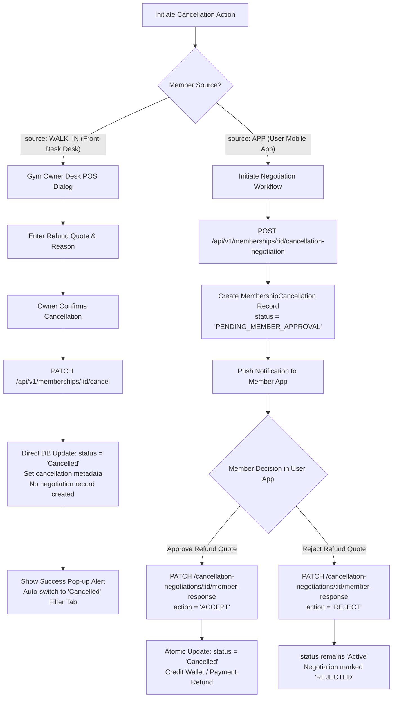
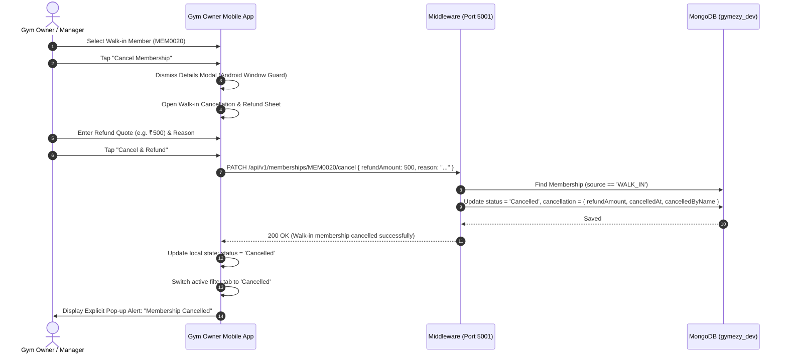
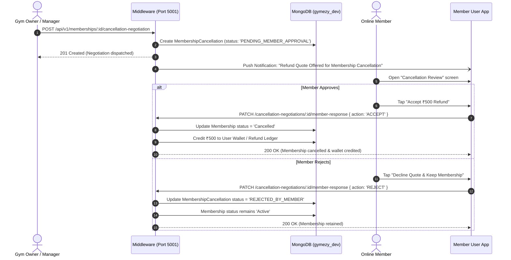

# Membership Cancellation Lifecycle Specification

**Version:** 1.0.0  
**Last Updated:** 2026-11-05  
**Scope:** Middleware API, Gym Owner Mobile App, Gym Owner Web Portal, User Mobile/Web App  
**Architecture Standard:** Single Source of Truth (SSOT), ACID Compliance, Role-Based Access Control  

---

## 1. Executive Summary

Gymezy enforces a **strict dual-lifecycle model** for membership cancellations based on the member acquisition source (`source: 'WALK_IN'` vs `source: 'APP'`). 

* **Walk-in Members (`WALK_IN`)**: Onboarded directly at the gym reception desk / POS. They do not maintain an active user app account or session. Therefore, cancellation is **executed immediately by the Gym Owner or Operational Admin** at the front desk with a specified refund quote. No bilateral negotiation or customer in-app approval is required.
* **Online User App Members (`APP`)**: Onboarded via the member-facing mobile/web application with verified digital wallets, stored payment methods, and authenticated user accounts. Cancellation follows a **bilateral negotiation and approval lifecycle** (`MembershipCancellation`) with explicit proration rules and member verification.

---

## 2. Architecture & Single Source of Truth (SSOT)



---

## 3. Detailed Lifecycle Comparison

| Lifecycle Dimension | Walk-in Members (`WALK_IN`) | User App Members (`APP`) |
| :--- | :--- | :--- |
| **Origin / Context** | Desk POS / Front Receptionist | Digital User App / Cloud Gateway |
| **User App Session** | None (Walk-in record) | Authenticated Member Session |
| **Approval Required?** | **None** (Direct gym owner decision) | **Yes** (Member must review and accept refund quote) |
| **Endpoint** | `PATCH /api/v1/memberships/:id/cancel` | `POST /api/v1/memberships/:id/cancellation-negotiation` |
| **Negotiation Queue** | Excluded from `cancellation-negotiations` queue | Included in `cancellation-negotiations` queue |
| **Refund Execution** | Recorded for offline counter settlement (Cash/UPI/Card) | Atomic credit to User Wallet or PG gateway reversal |
| **State Transition** | `Active` &rarr; `Cancelled` (Immediate) | `Active` &rarr; `Cancellation Requested` &rarr; `Cancelled` (or `Active` if rejected) |
| **Client Feedback** | Immediate native modal confirmation + Pop-up Alert (`Alert.alert`) | Negotiation pending dispatch notice & timeline tracking |

---

## 4. Sequence Diagrams

### 4.1 Walk-in Member Direct Cancellation



### 4.2 Online User App Member Cancellation Negotiation



---

## 5. Data Model & Database Schemas

### 5.1 Embedded `cancellationSchema` in `Membership`

Located at: [`middleware/src/models/membership.model.js`](file:///c:/Users/guru%20santhosh/OneDrive/Desktop/gymezy/middleware/src/models/membership.model.js)

```javascript
const cancellationSchema = new mongoose.Schema(
  {
    cancelledAt: { type: Date, default: null },
    reason: { type: String, trim: true, default: '' },
    refundAmount: { type: Number, default: 0, min: 0 },
    notes: { type: String, trim: true, default: '' },
    cancelledBy: { type: mongoose.Schema.Types.ObjectId, ref: 'User', default: null },
    cancelledByName: { type: String, trim: true, default: 'Gym Admin' },
  },
  { _id: false }
);
```

### 5.2 Membership Status Enum

```javascript
export const MEMBERSHIP_STATUS = [
  'Active',
  'Upcoming',
  'Expiring Soon',
  'Expired',
  'Cancelled',
];
```

---

## 6. API Endpoint Contracts

### 6.1 Walk-in Member Direct Cancellation

* **Route:** `PATCH /api/v1/memberships/:id/cancel`
* **Authorization:** Gym Owner, Operational Admin, or Super Admin (`optionalAuthenticate` / JWT bearer)
* **Request Body:**
  ```json
  {
    "refundAmount": 500,
    "reason": "Customer relocated to another city",
    "notes": "Counter cash refund disbursed at desk POS"
  }
  ```
* **Success Response (200 OK):**
  ```json
  {
    "success": true,
    "statusCode": 200,
    "message": "Walk-in membership cancelled successfully and refund quote recorded.",
    "data": {
      "_id": "6aec2bb5adef6c1628f6fe9c",
      "membershipId": "MEM0021",
      "status": "Cancelled",
      "source": "WALK_IN",
      "pricing": { "totalAmount": 1500 },
      "cancellation": {
        "cancelledAt": "2026-11-05T07:20:48.830Z",
        "reason": "Customer relocated to another city",
        "refundAmount": 500,
        "notes": "Counter cash refund disbursed at desk POS",
        "cancelledByName": "Thaingasaami"
      }
    }
  }
  ```
* **Error Scenarios:**
  * `400 Bad Request`: Membership already in `Cancelled` status.
  * `404 Not Found`: Membership `:id` does not exist.

### 6.2 Filter Gym Memberships by Status

* **Route:** `GET /api/v1/memberships/gym/:gymId?status=Cancelled`
* **Behavior:** Returns paginated list of memberships for `:gymId` matching `status: 'Cancelled'`.
* **Summary Counters:** Returns global metrics:
  ```json
  "summary": {
    "total": 17,
    "active": 12,
    "expiringSoon": 0,
    "expired": 0,
    "cancelled": 5
  }
  ```

---

## 7. Client-Side Implementation Standards

### 7.1 Android Native Modal Stacking Guard
In React Native Android (Fabric & Bridgeless runtimes), attempting to render a modal `<Modal visible={showWalkInCancelModal}>` while `<Modal visible={selectedMember !== null}>` is open causes the second modal to be blocked or hidden behind the native window.

**Resolution Standard:**
```javascript
// MembersTab.js
const handleRequestCancellation = (member) => {
  if (member.isWalkIn) {
    setWalkInCancelMember(member);
    setWalkInRefundAmount(String(member.rawAmount || 0));
    setWalkInCancelReason('Customer requested cancellation at counter');
    
    // CRITICAL FOR ANDROID: Dismiss details modal first before opening cancellation modal
    setSelectedMember(null);
    setTimeout(() => {
      setShowWalkInCancelModal(true);
    }, 120);
    return;
  }
  // Online member negotiation workflow...
};
```

### 7.2 UI State Transition & Tab Auto-Switch
Upon confirming cancellation of a walk-in member, the client:
1. Immediately mutates the local `members` array (`status = 'Cancelled'`, `daysLeft = 'Cancelled'`).
2. Switches `memberFilter` to `'Cancelled'` so the member is prominently visible under the **"Cancelled"** tab.
3. Triggers an explicit native pop-up alert (`Alert.alert`) detailing the member ID, name, refund quote, and reason.
4. If viewed in detail, presents a red **"Membership is Cancelled"** alert banner and disables the cancellation trigger.

---

## 8. Verification & Test Suite

Automated verification suite is maintained at [`middleware/test/walkin_cancellation.test.js`](file:///c:/Users/guru%20santhosh/OneDrive/Desktop/gymezy/middleware/test/walkin_cancellation.test.js):

* **Test 1**: Walk-in cancellation logic executes directly with refund quote without user approval.
* **Test 2**: Online App member requests generate `MembershipCancellation` and require member response.
* **Test 3**: Walk-in members are strictly excluded from the pending negotiation review queue.
* **Mobile Jest Suite**: Verified across all 11 suites and 62 unit tests in `mobile-application/gym-owner`.

