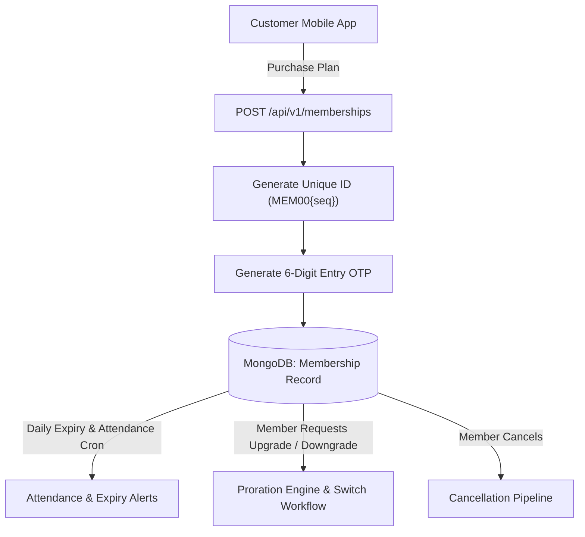
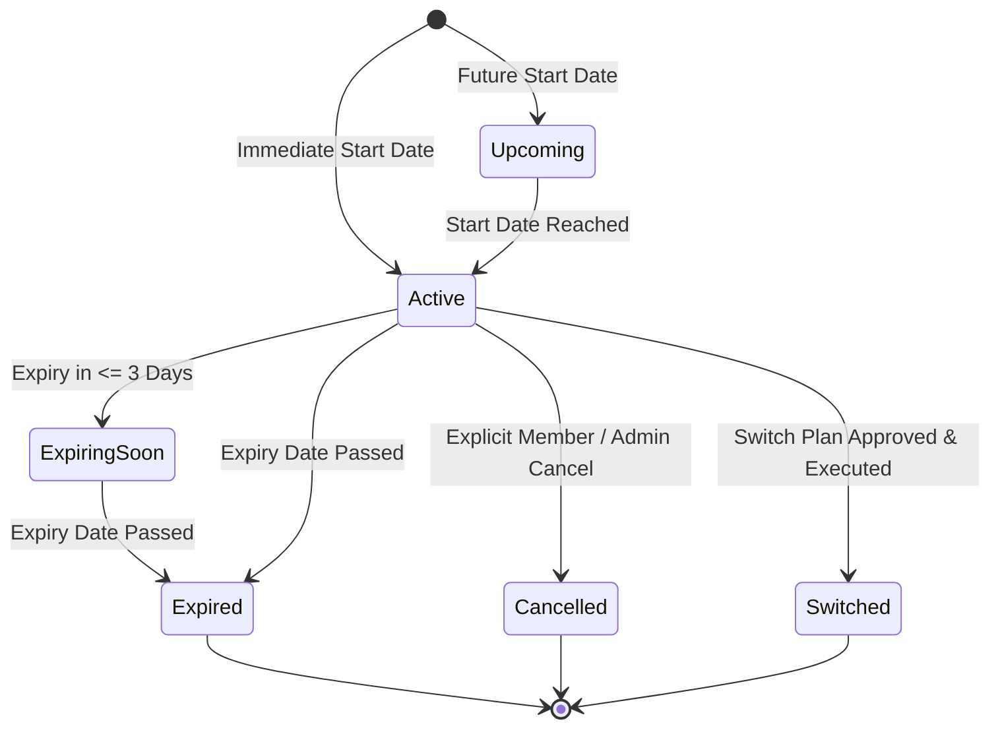
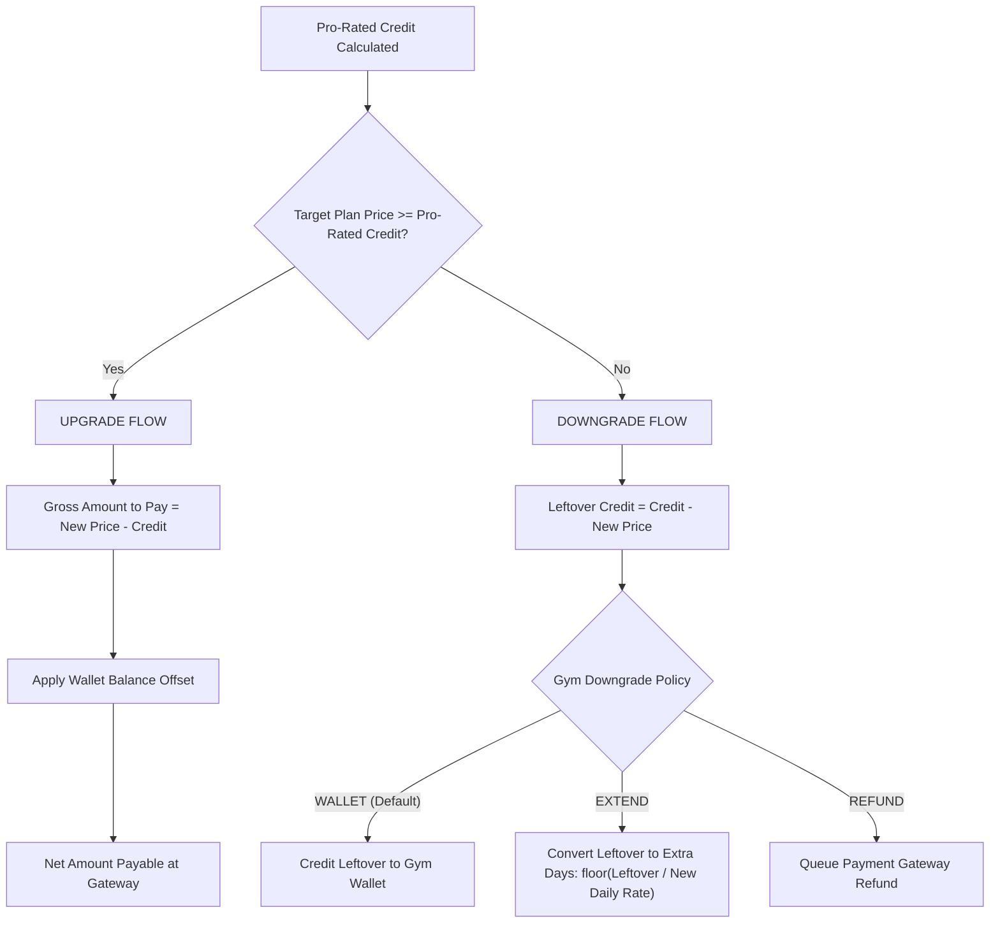
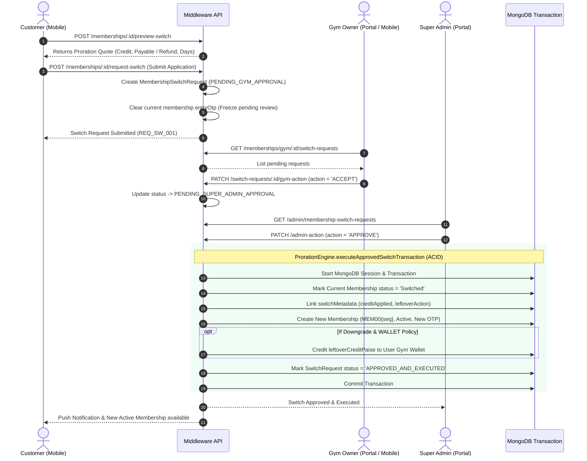

# GYMEZY Membership, Plan Update & Cancellation Specification

This document provides a comprehensive technical reference for the **Membership Lifecycle**, **Plan Switch & Proration Engine (Upgrade / Downgrade)**, and **Membership Cancellation Logic** across the GYMEZY platform.

---

## 1. Membership Architecture Overview

A Membership grants a customer verified gym floor access for a defined tier duration, with optional personal trainer coaching, digital entry OTP/QR generation, and attendance check-in verification.



---

## 2. Membership Tiers & Lifecycle States

### Standard Tiers & Durations
- **Monthly:** 30 Days (`monthly`)
- **Quarterly:** 90 Days (`quarterly`)
- **Half Yearly:** 180 Days (`halfYearly`)
- **Annual:** 365 Days (`annual`)

### Status Lifecycle State Machine



| Status | Description | Access Permissions |
|---|---|---|
| `Upcoming` | Membership purchased with a future start date. | No check-in until start date. |
| `Active` | Current valid active membership. | Full gym & trainer access with dynamic OTP. |
| `Expiring Soon` | Within 3 days of expiration; cron alerts triggered. | Access permitted; renewal CTA displayed. |
| `Expired` | End date reached; membership lapsed. | Access revoked. Entry OTP invalidated. |
| `Switched` | Replaced by an approved upgrade or downgrade plan. | Replaced by new membership document. |
| `Cancelled` | Terminated early by member or administration. | Access revoked immediately. |

---

## 3. Membership Purchase Flow

### Endpoint: `POST /api/v1/memberships`

#### Request Payload
```json
{
  "gymId": "6ac328b6651acef3f407f504",
  "membershipTier": "Monthly",
  "startDate": "2026-11-05T00:00:00.000Z",
  "trainerId": "6ab902b4e8910a3901b56a12",
  "trainerSlot": "06:00 AM - 07:00 AM",
  "paymentMethod": "UPI",
  "transactionId": "TXN_1730538900"
}
```

#### Processing Pipeline:
1. **Validation:** Checks gym validity, ensures tier is allowed, and verifies start date.
2. **Pricing Resolution:**
   - Base Tier Price fetched from `gym.pricingPlans[tierKey]` or `gym.customPricingPlans`.
   - Personal Trainer Fee resolved from `trainer.trainerPricing[tierKey]` (if `trainerId` supplied).
   - Total Amount: `basePrice + trainerFee`.
3. **Sequential Identifier:** Generates gym-scoped identifier `MEM00{counter}` using `Counter.getNextSequence('mem_<gymId>')`.
4. **Access Security:** Generates initial 6-digit random entry OTP (`entryOtp`).
5. **Persistence:** Saves document with status `Active` (or `Upcoming` if `startDate > today`).

---

## 4. Membership Update / Plan Switch Engine (Proration)

When a member upgrades (e.g. Monthly to Annual) or downgrades (e.g. Annual to Monthly), GYMEZY executes **integer paise-accurate financial proration** using [`ProrationEngine`](../middleware/src/services/proration.service.js).

### Proration Mathematical Model

1. **Date & Calendar Normalization:** All dates normalized to midnight UTC based on `Asia/Kolkata` (`diffCalendarDays`).
2. **Paused Days Exclusion:** Any days the membership was temporarily frozen are subtracted from elapsed days:
   $$\text{Days Used} = \max(0, \text{Days Elapsed} - \text{Total Paused Days})$$
   $$\text{Days Remaining} = \max(0, \text{Duration Days} - \text{Days Used})$$
3. **Daily Burn Rate:**
   $$\text{Per Day Cost (Paise)} = \left\lfloor \frac{\text{Current Plan Price (Paise)}}{\text{Duration Days}} \right\rceil$$
4. **Pro-rated Credit:**
   $$\text{Pro-Rated Credit (Paise)} = \begin{cases} 
      \min(\text{Current Price}, \text{Days Remaining} \times \text{Per Day Cost}), & \text{if Days Remaining} > 0 \\
      0, & \text{if Expired}
   \end{cases}$$

### Switch Classification



---

## 5. Two-Tier Approval & Atomic Execution Workflow

To protect both gym owners and platform integrity, plan switch requests follow a strict two-tier approval lifecycle:



### Rejection Paths
- **Gym Owner Rejection:** Request status set to `REJECTED_BY_GYM`. Current membership remains Active with entry OTP restored.
- **Super Admin Rejection:** Request status set to `REJECTED_BY_SUPER_ADMIN`. Current membership remains Active.

---

## 6. Membership Cancellation Logic

### Endpoint: `PATCH /api/v1/memberships/:id/cancel`

#### Processing Logic:
```javascript
// Locate membership by ObjectId or custom MEM00x ID
const membership = await Membership.findOne(query);

if (membership.status === 'Cancelled') {
  throw ApiError.badRequest('Membership is already cancelled.');
}

// 1. Terminate status
membership.status = 'Cancelled';

// 2. Record audit metadata
membership.cancellation = {
  cancelledAt: new Date(),
  reason: req.body.reason || 'Cancelled by member',
  cancelledBy: req.user?._id,
  cancelledByRole: req.user?.role || 'MEMBER',
};

// 3. Invalidate access credentials
membership.entryOtp = null;

await membership.save();
```

#### Effects of Cancellation:
1. **Access Revocation:** Digital pass displays `Cancelled` status badge; QR scanning at gym turnstile/reception rejects entry.
2. **Attendance Lockout:** Prevents any subsequent attendance logs for this `membershipId`.
3. **Audit History:** Recorded in Super Admin and Gym Owner membership reports with cancellation timestamp and reason.

---

## 7. Data Models & Schemas

### `Membership` Document Schema Highlights
```typescript
interface MembershipDocument {
  membershipId: string;           // e.g. "MEM0014"
  gymId: ObjectId;                // References Gym
  gymPartnerId: string;           // e.g. "GYM4"
  userId: ObjectId;               // References User
  trainerId?: ObjectId;           // Optional Personal Coach
  hasTrainer: boolean;
  trainerSlot?: string;           // e.g. "06:00 AM - 07:00 AM"
  membershipTier: 'Monthly' | 'Quarterly' | 'Half Yearly' | 'Annual';
  durationDays: number;
  startDate: Date;
  endDate: Date;
  status: 'Active' | 'Upcoming' | 'Expiring Soon' | 'Expired' | 'Cancelled' | 'Switched';
  entryOtp?: string;              // 6-digit dynamic OTP
  pricing: {
    basePrice: number;
    trainerFee: number;
    totalAmount: number;
    currency: 'INR';
  };
  cancellation?: {
    cancelledAt: Date;
    reason: string;
    cancelledBy: ObjectId;
    cancelledByRole: string;
  };
  switchMetadata?: {
    switchType: 'UPGRADE' | 'DOWNGRADE' | 'RENEWAL';
    switchedAt: Date;
    previousMembershipId?: ObjectId;
    replacedByMembershipId?: ObjectId;
    daysUsed: number;
    daysRemaining: number;
    proRatedCreditPaise: number;
    leftoverCreditPaise: number;
    leftoverActionTaken: 'NONE' | 'WALLET_CREDITED' | 'REFUNDED' | 'EXTENDED_DAYS';
    extraDaysAwarded: number;
  };
}
```

### `MembershipSwitchRequest` Schema Highlights
```typescript
interface MembershipSwitchRequestDocument {
  requestId: string;              // e.g. "REQ_SW_005"
  membershipId: ObjectId;
  gymId: ObjectId;
  userId: ObjectId;
  targetTier: 'Monthly' | 'Quarterly' | 'Half Yearly' | 'Annual';
  targetPlanId: string;
  quoteSnapshot: {
    switchType: 'UPGRADE' | 'DOWNGRADE';
    currentPricePaise: number;
    proRatedCreditPaise: number;
    newPricePaise: number;
    grossPayablePaise: number;
    walletDeductionPaise: number;
    netAmountToPayPaise: number;
    leftoverCreditPaise: number;
    extraDaysAwarded: number;
    effectiveNewDurationDays: number;
    downgradePolicy: 'WALLET' | 'EXTEND' | 'REFUND';
  };
  status: 
    | 'PENDING_GYM_APPROVAL'
    | 'PENDING_SUPER_ADMIN_APPROVAL'
    | 'APPROVED_AND_EXECUTED'
    | 'REJECTED_BY_GYM'
    | 'REJECTED_BY_SUPER_ADMIN'
    | 'CANCELLED_BY_USER';
  gymApproval?: ApprovalAudit;
  superAdminApproval?: ApprovalAudit;
}
```

---

## 8. Summary of API Endpoints

| Method | Endpoint | Authorization | Description |
|---|---|---|---|
| `POST` | `/api/v1/memberships` | Authenticated / Member | Purchase new membership tier |
| `GET` | `/api/v1/memberships/my` | Member | List current & past user memberships |
| `GET` | `/api/v1/memberships/:id` | Member / Owner / Admin | Retrieve membership details & QR pass |
| `PATCH` | `/api/v1/memberships/:id/cancel` | Member / Owner / Admin | Terminate active membership |
| `POST` | `/api/v1/memberships/:id/preview-switch` | Member | Dry-run proration quote calculation |
| `POST` | `/api/v1/memberships/:id/request-switch` | Member | Submit upgrade/downgrade request |
| `GET` | `/api/v1/memberships/my/switch-requests` | Member | View switch application history |
| `GET` | `/api/v1/memberships/gym/:gymId/switch-requests` | Gym Owner | View gym's switch requests |
| `PATCH` | `/api/v1/memberships/switch-requests/:id/gym-action` | Gym Owner | Accept or reject switch application |
| `GET` | `/api/v1/admin/membership-switch-requests` | Super Admin | Fleet view of all pending switches |
| `PATCH` | `/api/v1/admin/membership-switch-requests/:id/admin-action` | Super Admin | Final approval & ACID execution |

