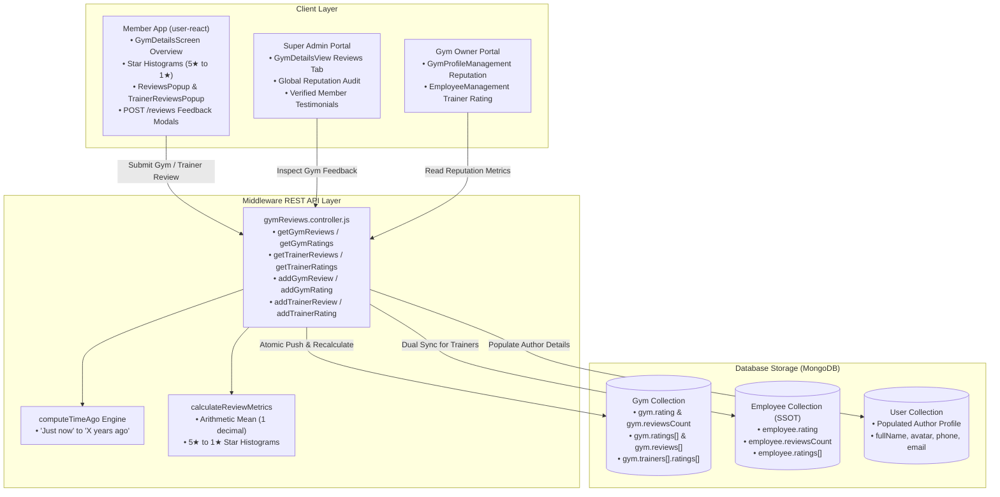

<!-- covers: middleware/src/controllers/gymReviews.controller.js middleware/src/models/gym.model.js middleware/src/models/employee.model.js mobile-application/user-react/src/pages/GymDetailsScreen.js mobile-application/user-react/src/widgets/DetailsPopups.js web-application/super-admin/src/admin/components/GymDetailsView.jsx web-application/gym-owner/src/owner/components/GymProfileManagement.jsx -->

# Gym & Trainer Ratings and Reviews Specification

This document defines the architectural specification, database models, aggregation mathematics, REST API contracts, and cross-platform UI implementations for the **Ratings and Reviews Subsystem** across the GYMEZY platform.

---

## 1. Subsystem Architecture Overview

The GYMEZY Ratings & Reviews subsystem provides a dual-entity social proof and reputation engine that serves two distinct entities:
1. **Gym Facilities & Studios**: Overall venue cleanliness, equipment quality, crowd level, and facility maintenance.
2. **Personal Trainers & Coaches**: Coach attentiveness, workout program design, punctuality, and motivational guidance.



---

## 2. Data Models & Schemas

The reviews subsystem utilizes embedded document arrays with Mongoose population linking to author `User` accounts.

### 2.1 The Embedded Review Schema (`reviewSchema`)

Defined in `middleware/src/models/gym.model.js`:

```javascript
const reviewSchema = new mongoose.Schema(
  {
    userId: { type: mongoose.Schema.Types.ObjectId, ref: 'User', index: true },
    userName: { type: String, trim: true, default: '' },
    userImageUrl: { type: String, trim: true, default: '' },
    rating: { type: Number, required: true, min: 1, max: 5, default: 5 },
    comment: { type: String, required: true, trim: true },
    bookingType: { type: String, trim: true, default: 'Member' },
    date: { type: String, trim: true, default: 'Recent' },
    createdAt: { type: Date, default: Date.now },
  },
  { _id: true }
);
```

| Field | Type | Description |
|---|---|---|
| `userId` | `ObjectId (ref: User)` | Unique reference to the reviewing member account. Used for real-time profile population (`fullName`, `avatar`, `phone`). |
| `userName` | `String` | Snapshot fallback name displayed if user profile lookup is unpopulated or deleted. |
| `userImageUrl` | `String` | Snapshot fallback avatar URL. |
| `rating` | `Number` | Star rating integer or float bounded between `1.0` and `5.0`. |
| `comment` | `String` | Member's textual review narrative or testimonial. |
| `bookingType` | `String` | Contextual booking badge (e.g. `'Member'`, `'Daily Pass'`, `'Personal Training'`, `'Group Class'`). |
| `date` | `String` | Relative time label generated via `computeTimeAgo(createdAt)`. |
| `createdAt` | `Date` | Timestamp of submission (defaults to `Date.now`). |

### 2.2 Gym Model Schema Integration

In `middleware/src/models/gym.model.js`:
- `rating`: Summary numeric score (default `4.9`, min `0`, max `5`).
- `reviewsCount`: Total number of submitted reviews (default `0`, min `0`).
- `ratings`: Array of embedded `reviewSchema` entries.
- `reviews`: Synchronized alias array of embedded `reviewSchema` entries for backward and forward compatibility.

### 2.3 Trainer & Employee Schema Integration (SSOT)

Trainers can exist both as embedded documents in `gym.trainers` and as primary records in the `Employee` collection:
- `employee.rating`: Coach star score (default `4.9`).
- `employee.reviewsCount`: Total coach reviews count.
- `employee.ratings`: Array of member review objects.
- When a review is posted via `POST /api/v1/gyms/:id/trainers/:trainerId/reviews`, the backend performs an atomic update on **both** the `Employee` model and the embedded `gym.trainers` record to maintain strict consistency across administrative and user-facing channels.

---

## 3. Mathematical Metrics & Aggregation Engine

### 3.1 Star Rating Calculation
Given an array of $N$ reviews $\{r_1, r_2, \dots, r_N\}$ where $1 \le r_i \le 5$:

$$\bar{R} = \frac{1}{N} \sum_{i=1}^{N} r_i$$

The numeric average is rounded to 1 decimal place:
```javascript
const avgNum = sum / reviews.length;
const avgStr = avgNum.toFixed(1);
```

### 3.2 Star Distribution Histograms
For each star tier $s \in \{5, 4, 3, 2, 1\}$:
1. Count the occurrences: $C_s = \sum_{i=1}^{N} \mathbb{I}(\text{round}(r_i) = s)$
2. Compute the distribution ratio: $\text{ratio}_s = \frac{C_s}{N}$
3. Format as a percentage string: $\text{percent}_s = \text{round}(\text{ratio}_s \times 100) + '\%' $

If $N = 0$, the engine returns a standardized zero-state histogram:
```json
[
  { "stars": 5, "count": 0, "ratio": 0, "percent": "0%" },
  { "stars": 4, "count": 0, "ratio": 0, "percent": "0%" },
  { "stars": 3, "count": 0, "ratio": 0, "percent": "0%" },
  { "stars": 2, "count": 0, "ratio": 0, "percent": "0%" },
  { "stars": 1, "count": 0, "ratio": 0, "percent": "0%" }
]
```

### 3.3 Relative Time Formatting Engine (`computeTimeAgo`)

Relative dates are computed dynamically on query time:
- $\Delta t < 60\text{s} \implies \text{'Just now'}$
- $60\text{s} \le \Delta t < 3600\text{s} \implies \text{'$M$ min' / '$M$ mins ago'}$
- $1\text{h} \le \Delta t < 24\text{h} \implies \text{'$H$ hr' / '$H$ hrs ago'}$
- $1\text{d} \le \Delta t < 30\text{d} \implies \text{'$D$ day' / '$D$ days ago'}$
- $30\text{d} \le \Delta t < 365\text{d} \implies \text{'$Mo$ month' / '$Mo$ months ago'}$
- $\Delta t \ge 365\text{d} \implies \text{'$Y$ year' / '$Y$ years ago'}$

---

## 4. REST API Endpoint Contracts

### 4.1 Get Gym Ratings & Reviews

- **Endpoint**: `GET /api/v1/gyms/:id/reviews` (Alias: `GET /api/v1/gyms/:id/ratings`)
- **Access**: Public (`optionalAuthenticate`)
- **Identifier**: `:id` can be Mongo `_id`, `partnerId` (e.g. `'GYM001'`), or location `slug`.
- **Response Format (`200 OK`)**:

```json
{
  "success": true,
  "message": "Gym ratings & reviews retrieved successfully",
  "data": {
    "gymId": "GYM001",
    "gymName": "FitZone Luxury Club - Anna Nagar",
    "rating": "4.9",
    "numericRating": 4.9,
    "reviewsCount": 128,
    "hasReviews": true,
    "histograms": [
      { "stars": 5, "count": 102, "ratio": 0.7968, "percent": "80%" },
      { "stars": 4, "count": 20, "ratio": 0.1562, "percent": "16%" },
      { "stars": 3, "count": 4, "ratio": 0.0312, "percent": "3%" },
      { "stars": 2, "count": 2, "ratio": 0.0156, "percent": "2%" },
      { "stars": 1, "count": 0, "ratio": 0.0, "percent": "0%" }
    ],
    "reviews": [
      {
        "userId": "660c1f54e123456789abc001",
        "userName": "Priya Sharma",
        "userImageUrl": "https://storage.gymezy.com/avatars/priya.jpg",
        "userPhone": "+919876543210",
        "rating": 5,
        "comment": "Exceptional equipment and steam room facilities. Trainers are super supportive!",
        "bookingType": "Member",
        "date": "2 days ago",
        "createdAt": "2026-11-08T08:30:00.000Z"
      }
    ]
  }
}
```

### 4.2 Submit Member Review for Gym

- **Endpoint**: `POST /api/v1/gyms/:id/reviews` (Alias: `POST /api/v1/gyms/:id/ratings`)
- **Access**: Authenticated (`authenticate` middleware)
- **Request Payload**:

```json
{
  "rating": 5,
  "comment": "Outstanding training atmosphere and clean lockers.",
  "bookingType": "Daily Pass"
}
```

- **Validation Rules**:
  - `rating`: Required number between `1` and `5`.
  - `comment`: Sanitized string.
  - Automatically captures `userId`, `fullName`, and `avatar` from the authenticated user token.
- **Side Effects**:
  - Pushes new review to beginning of `gym.ratings` and `gym.reviews`.
  - Recalculates average `gym.rating` and updates `gym.reviewsCount`.
  - Saves document atomically.

### 4.3 Get Trainer Ratings & Reviews

- **Endpoint**: `GET /api/v1/gyms/:id/trainers/:trainerId/reviews` (Alias: `GET /api/v1/gyms/:id/trainers/:trainerId/ratings`)
- **Access**: Public (`optionalAuthenticate`)
- **Parameters**:
  - `:id`: Gym identifier (ID, partnerId, or slug).
  - `:trainerId`: Trainer identifier (Employee ObjectId, employee ID e.g. `'EMP001'`, or URL-encoded name e.g. `'Vikram%20Aditya'`).
- **Response Format (`200 OK`)**:

```json
{
  "success": true,
  "message": "Trainer reviews retrieved successfully",
  "data": {
    "gymId": "GYM001",
    "gymName": "FitZone Luxury Club - Anna Nagar",
    "trainer": {
      "name": "Vikram Aditya",
      "specialty": "CrossFit & Olympic Lifting",
      "experienceYears": 6,
      "rating": "4.9",
      "reviewsCount": 42,
      "imageUrl": "https://storage.gymezy.com/trainers/vikram.jpg"
    },
    "hasReviews": true,
    "rating": "4.9",
    "numericRating": 4.9,
    "reviewsCount": 42,
    "histograms": [
      { "stars": 5, "count": 38, "ratio": 0.904, "percent": "90%" },
      { "stars": 4, "count": 4, "ratio": 0.095, "percent": "10%" },
      { "stars": 3, "count": 0, "ratio": 0, "percent": "0%" },
      { "stars": 2, "count": 0, "ratio": 0, "percent": "0%" },
      { "stars": 1, "count": 0, "ratio": 0, "percent": "0%" }
    ],
    "reviews": [
      {
        "userId": "660c1f54e123456789abc002",
        "userName": "Rahul Krishnan",
        "userImageUrl": "",
        "userPhone": "+919876543211",
        "rating": 5,
        "comment": "Vikram completely transformed my deadlift technique within 3 weeks.",
        "bookingType": "Personal Training",
        "date": "1 week ago",
        "createdAt": "2026-11-03T10:15:00.000Z"
      }
    ]
  }
}
```

### 4.4 Submit Member Review for Trainer

- **Endpoint**: `POST /api/v1/gyms/:id/trainers/:trainerId/reviews` (Alias: `POST /api/v1/gyms/:id/trainers/:trainerId/ratings`)
- **Access**: Authenticated (`authenticate` middleware)
- **Request Payload**:

```json
{
  "rating": 5,
  "comment": "Incredible coach! Very patient and tailored routines to my shoulder injury.",
  "bookingType": "Personal Training"
}
```

- **Dual Sync Mechanics**:
  1. Searches for trainer in `Employee` collection (where `role: 'Trainer'`).
  2. Updates `employee.ratings`, `employee.reviewsCount`, and `employee.rating`.
  3. Locates corresponding embedded coach in `gym.trainers`.
  4. Updates embedded `trainer.ratings`, `trainer.reviewsCount`, and `trainer.rating`.
  5. Both documents are saved, guaranteeing consistent state across all consumers.

---

## 5. Cross-Platform UI Implementations

### 5.1 Member Mobile Application (`mobile-application/user-react`)

1. **`GymDetailsScreen.js`**:
   - Computes live review statistics with `useMemo`.
   - Renders hero rating badge (`⭐ 4.9`).
   - Displays **Reviews Overview Card** containing the large rating number, verified review count, and visual horizontal histogram bars for 5★, 4★, 3★, 2★, 1★.
   - Shows top 2 recent member testimonials with user avatar, name, and relative date.
   - Includes `"View All (X) Reviews"` action triggering full-screen popup modal.
2. **`DetailsPopups.js`**:
   - `ReviewsPopup`: Full scrollable modal listing all gym reviews with star rating breakdown, reviewer name, avatar, booking type badge, and relative timestamp.
   - `TrainerReviewsPopup`: Detailed coach credential popup displaying bio, certifications, languages, experience years, and client testimonials list.
3. **`SessionBookingFlow.js`**:
   - In Step 2 (*Choose Personal Coach*), each coach card displays live star score and review tally (e.g. `⭐ 4.9 (42)`) alongside the "Rates & Bio" link.

### 5.2 Super Admin Web Console (`web-application/super-admin`)

1. **`GymDetailsView.jsx`**:
   - Contains a dedicated tab **`reviews`** (*Customer Testimonials & Reviews*).
   - Fetches `GET /api/v1/gyms/:id/reviews` using `apiClient`.
   - Top banner displays Average Rating metric card, total verified reviews, and recommendation score.
   - Renders visual Ant Design progress bars for star distribution.
   - Renders complete customer feedback table with reviewer avatar, verified phone, booking source, star rating, and timestamp.

### 5.3 Gym Owner Web Portal (`web-application/gym-owner`)

1. **`GymProfileManagement.jsx`**:
   - Displays gym public rating summary (`⭐ 4.9 / 5.0`) and total verified reviews.
   - Displays Google review integration count in the social links section.
2. **`EmployeeManagement.jsx`**:
   - Lists onboarded staff and trainers with their current rating badge (`⭐ 4.9`) and total client reviews count (`(X reviews)`).

---

## 6. Seed Data Pipeline

In `middleware/src/scripts/seed100ChennaiGyms.js`:
- Each of the 100 gyms is seeded with authentic member feedback linked to seeded customer user profiles.
- Gym ratings are pre-calculated between `4.5` and `5.0`.
- Trainers assigned to each gym are pre-populated with realistic reviews count ($15$ to $80+$) and client ratings.

---

## 7. Testing & Verification

The subsystem is verified via automated test suite in [`middleware/test/gym_reviews_ratings.test.js`](file:///Users/yovelr/Softrate/GYMEZY/middleware/test/gym_reviews_ratings.test.js):

```bash
node --test middleware/test/gym_reviews_ratings.test.js
```

Test coverage includes:
1. Registration and routing of all public and authenticated review endpoints.
2. Accuracy of relative time calculations in `computeTimeAgo`.
3. Mathematical validation of average rating formulas and star histogram percentages.
4. Input validation and boundary enforcement for 1 to 5 star ratings.

