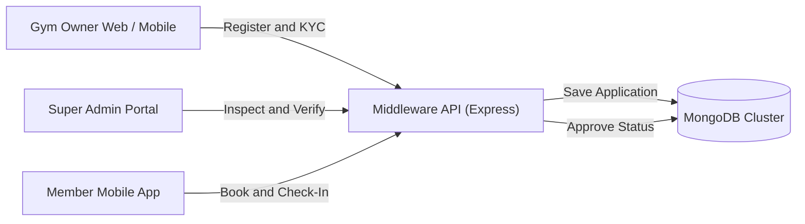

# GYMEZY Platform Documentation Directory

Welcome to the official technical documentation repository for the **GYMEZY** enterprise fitness platform.

## Documentation Index

| Document | Description | Target Platforms |
|---|---|---|
| **[GYM_DISCOVERY_INFINITE_SCROLL_AND_SEEDING_SPECIFICATION.md](./GYM_DISCOVERY_INFINITE_SCROLL_AND_SEEDING_SPECIFICATION.md)** | **Gym Discovery, Infinite Scrolling & Geospatial Seeding Specification**. Details server-side proximity pagination (`GET /api/v1/gyms`), Haversine distance-sorted streaming, client-side infinite scroll engine (`HomeScreen.js`), automated 100 Chennai localities seeder, SSOT trainer synchronization, and Group Classes batch UI redesign. | User Mobile, Super Admin Web, Gym Owner Web, Middleware API |
| **[GYM_PROFILE_MANAGEMENT_SPECIFICATION.md](./GYM_PROFILE_MANAGEMENT_SPECIFICATION.md)** | **Gym Profile Management & Configuration Specification**. Details the 9-part profile data architecture (`gym.model.js`), operating hours and split shift engine, pricing tiers & day pass configuration, facility amenities, gallery branding, banking settlements, and the `pendingManagerEdits` delegation workflow. | Gym Owner Web, Gym Owner Mobile, Super Admin Web, User Mobile, Middleware API |
| **[EMPLOYEE_ONBOARDING_AND_MANAGER_ROLE_SPECIFICATION.md](./EMPLOYEE_ONBOARDING_AND_MANAGER_ROLE_SPECIFICATION.md)** | **Employee Onboarding & Manager Delegation Specification**. Details full-time vs. part-time onboarding pipelines, automatic RBAC (`computeAccessTypeFromRole`), manager 4-tier delegation permissions (`requireStaffApproval`, `requirePlanSwitchApproval`, `requireCancellationApproval`, `requireProfileEditApproval`), trainer catalog auto-sync (`syncGymTrainersFromEmployees`), and audit history. | Gym Owner Web, Gym Owner Mobile, Super Admin Web, Middleware API |
| **[WALKIN_MODEL_AND_DESK_OPERATIONS.md](./WALKIN_MODEL_AND_DESK_OPERATIONS.md)** | **Walk-in Model & Front-Desk Operations Specification**. Details offline visitor booking and membership creation, customer identity auto-resolution (`findOrCreateWalkInCustomer`), counter payment settlement (`Cash`, `UPI`, `Card`), fast turnstile phone-lookup check-in, and `source` (`APP` vs `WALK_IN`) tracking across schemas and dashboards. | Gym Owner Web, Gym Owner Mobile, Super Admin Web, Middleware API |
| **[GYM_MANAGER_ADMIN_DELEGATION_FLOW.md](./GYM_MANAGER_ADMIN_DELEGATION_FLOW.md)** | **Gym Manager vs. Gym Admin Delegation Architecture Specification**. Details the removal of Super Admin from operational tasks, Gym Admin autonomous direct execution, 4 granular Manager delegation permissions (`requireStaffApproval`, `requirePlanSwitchApproval`, `requireCancellationApproval`, `requireProfileEditApproval`), multi-channel alerting (FCM, dashboard badges, inline cards), and API contracts. | Gym Owner Web, Gym Owner Mobile, Super Admin Web, Middleware API |
| **[GIT_FORKING_WORKFLOW.md](./GIT_FORKING_WORKFLOW.md)** | **Team Git Forking & PR Review Workflow**. Details the 2-tier upstream/origin architecture, developer fork setup, daily branch lifecycle, Tech Lead (TL) code review gate, and automated VPS deployment triggers. | GitHub Organization, Tech Lead, Team Developers |
| **[CI_CD_DEPLOYMENT_WORKFLOW.md](./CI_CD_DEPLOYMENT_WORKFLOW.md)** | **CI/CD Deployment & VPS Infrastructure Specification**. Details GitHub Actions workflows for `dev` and `prod` branches, SSH automation, server deployment scripts, environment secrets, and PM2/Nginx reload triggers. | Hostinger VPS, GitHub Actions, Dev & Prod Environments |
| **[WALLET_FINANCIAL_ARCHITECTURE.md](./WALLET_FINANCIAL_ARCHITECTURE.md)** | **Gym-Specific Wallet & Financial Ledger Specification**. Details the multi-tenant financial isolation boundary, compound indexing `{userId, gymId}`, checkout debit checks, gym-scoped top-ups/payouts, and proration credit mechanics. | User Mobile, Gym Owner Web, Super Admin Web, Middleware API |
| **[ATTENDANCE_CHECKIN_CHECKOUT_FLOW.md](./ATTENDANCE_CHECKIN_CHECKOUT_FLOW.md)** | **Unified Attendance Check-In & Check-Out Specification**. Details the smart tap-in/tap-out toggle, QR & OTP resolution across Memberships, Sessions, Custom Dates, and Group Classes, anti-double scan cooldown, and stale session cleanup. | User Mobile, Gym Owner Mobile, Gym Owner Web, Middleware API |
| **[SESSION_BOOKING_FLOW.md](./SESSION_BOOKING_FLOW.md)** | **Unified Session & Class Booking Specification**. Details the reusable `SessionBookingFlow` component, 3 booking tiers (Per Session, Weekly Plan, Custom Dates), trainer add-on calculations, admin category controls, and checkout data contracts. | User Mobile, Gym Owner Web, Super Admin Web, Middleware API |
| **[MEMBERSHIP_FLOW.md](./MEMBERSHIP_FLOW.md)** | **Membership, Plan Update & Cancellation Specification**. Details the membership lifecycle, ProrationEngine mathematical model for upgrades/downgrades, two-tier approval workflow, cancellation mechanics, and wallet settlement. | User Mobile, Gym Owner Web, Super Admin Web, Middleware API |
| **[AUTHENTICATION_FLOW.md](./AUTHENTICATION_FLOW.md)** | **Master Authentication & Session Lifecycle Specification**. Full authorization lifecycle covering Customer, Gym Owner, and Super Admin authentication, Firebase JWT verification, RBAC matrices, and biometric lock. | All Platforms & Middleware API |
| **[BUILD_COMMANDS.md](./BUILD_COMMANDS.md)** | **Mobile & Web Application Build Commands Directory**. Command reference for building, running, and bundling both mobile apps (User React Expo & Gym Owner RN CLI) and web portals. | User Mobile, Gym Owner Mobile, Gym Owner Web, Super Admin Web |
| **[VPS_DATABASE_ACCESS_GUIDE.md](./VPS_DATABASE_ACCESS_GUIDE.md)** | **Remote VPS Database Access & Connectivity Specification**. Details remote MongoDB access, bypassing cellular/ISP port 27017 blocks via port 8443 redirection, MongoDB Compass GUI setup, SSH tunneling, and Fail2ban troubleshooting. | Developers, DevOps, Backend Engineers |
| **[MEMBERSHIP_CANCELLATION_LIFECYCLE.md](./MEMBERSHIP_CANCELLATION_LIFECYCLE.md)** | **Membership Cancellation & Prorated Refund Lifecycle**. Details automatic walk-in instant refund quotes, online app cancellation negotiations, gym manager approval rules, and unconsumed days proration math. | Gym Owner Web, Super Admin Web, User Mobile, Middleware API |
| **[RATINGS_AND_REVIEWS_SPECIFICATION.md](./RATINGS_AND_REVIEWS_SPECIFICATION.md)** | **Gym & Trainer Ratings and Reviews Specification**. Details the dual-entity reputation engine, embedded `reviewSchema` architecture, arithmetic rating averages, star distribution histograms (5★ to 1★), dynamic `computeTimeAgo` engine, public and authenticated REST endpoints, and cross-platform UI implementations. | User Mobile, Super Admin Web, Gym Owner Web, Middleware API |
| **[changelog.md](./changelog.md)** | **Project Changelog**. Tracks all notable releases, feature additions, behavior changes, deprecations, and fixes across the platform. | All Platforms |
| **[LOGIC_FLOW.md](./LOGIC_FLOW.md)** | **Master Production Logic Flow & Architecture Specification**. Contains end-to-end Mermaid sequence diagrams, state machines, RBAC tables, registration & verification flows, API contracts, Mongoose models, and cross-platform network architecture. | Super Admin Web, Gym Owner Web, Gym Owner Mobile, Middleware API |

---

## Quick Reference Architecture

