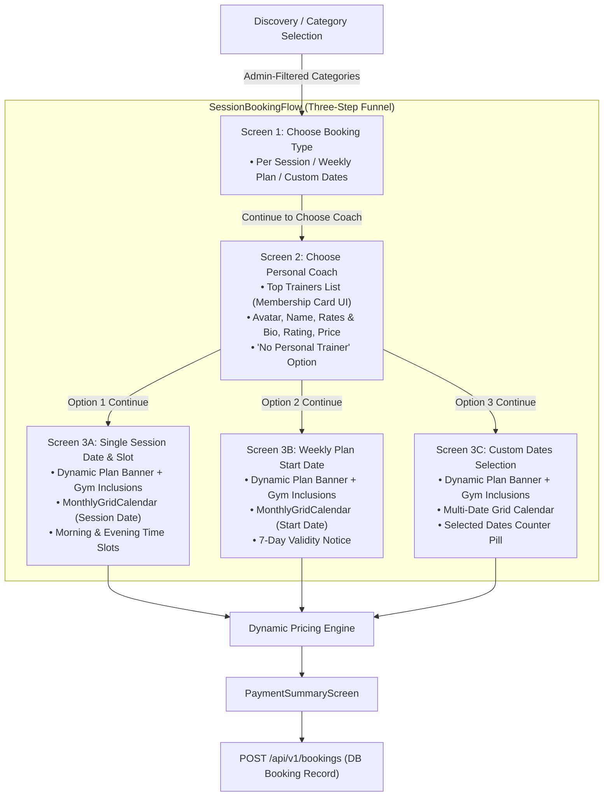
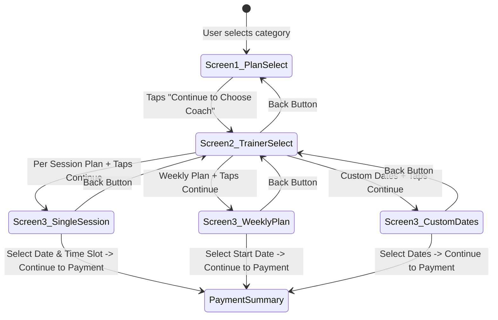
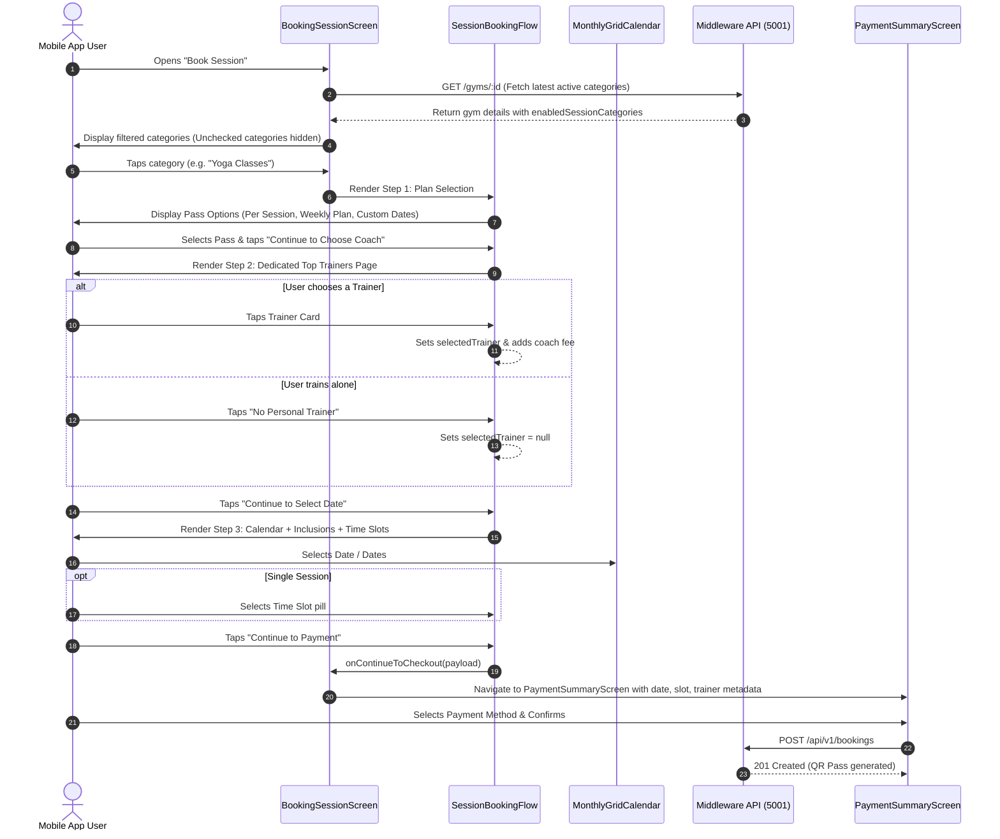

# GYMEZY Unified Session & Class Booking Specification

This document details the architecture, component hierarchy, data models, and end-to-end execution flow of the **Unified Session Booking System** across the GYMEZY platform.

---

## 1. System Architecture

The **Unified Session Booking System** provides a standardized, component-driven booking pipeline for all facility pass types and fitness classes (Gym Access, Yoga Classes, Zumba Sessions, HIIT, CrossFit, Pilates, Kickboxing, and Dance Fitness).

> **Group Classes Navigation Rule:**  
> Group Classes represent pre-scheduled, trainer-led cohort batches with set start/end dates, max capacities, and batch fees. Unlike generic floor passes, selecting **Group Classes** bypasses the generic booking type selector (Per Session, Weekly, Custom Dates) and navigates directly to the **Group Classes & Batches** catalog view (`currentView: 'group_classes'`), allowing users to browse and enroll into specific trainer-led batches immediately.



---

## 2. Dynamic Data Architecture & Category Configuration

The configuration dictionary `SESSION_CONFIGS` in [`SessionBookingFlow.js`](../mobile-application/user-react/src/widgets/SessionBookingFlow.js) maintains visual banner assets and category identifiers:

```javascript
export const SESSION_CONFIGS = {
  'Gym Access': {
    id: 'gym_access',
    title: 'Gym Access',
    icon: 'fitness-center',
    category: 'gym',
    heroImage: 'https://images.unsplash.com/photo-1534438327276-14e5300c3a48?q=80&w=800&auto=format&fit=crop',
  },
  'Group Classes': {
    id: 'group_classes',
    title: 'Group Classes',
    icon: 'groups',
    category: 'group',
    heroImage: 'https://images.unsplash.com/photo-1571902943202-507ec2618e8f?q=80&w=800&auto=format&fit=crop',
  },
  'Yoga Classes': {
    id: 'yoga',
    title: 'Yoga Classes',
    icon: 'self-improvement',
    category: 'yoga',
    heroImage: 'https://images.unsplash.com/photo-1544367567-0f2fcb009e0b?q=80&w=800&auto=format&fit=crop',
  },
  'Zumba Sessions': {
    id: 'zumba',
    title: 'Zumba Sessions',
    icon: 'music-note',
    category: 'zumba',
    heroImage: 'https://images.unsplash.com/photo-1518611012118-696072aa579a?q=80&w=800&auto=format&fit=crop',
  },
  'HIIT': {
    id: 'hiit',
    title: 'HIIT (High Intensity)',
    icon: 'bolt',
    category: 'hiit',
    heroImage: 'https://images.unsplash.com/photo-1601422407692-ec4eeec1d9b3?q=80&w=800&auto=format&fit=crop',
  },
  'CrossFit': {
    id: 'crossfit',
    title: 'CrossFit Training',
    icon: 'fitness-center',
    category: 'crossfit',
    heroImage: 'https://images.unsplash.com/photo-1517838277536-f5f99be501cd?q=80&w=800&auto=format&fit=crop',
  },
  'Pilates': {
    id: 'pilates',
    title: 'Pilates Core',
    icon: 'spa',
    category: 'pilates',
    heroImage: 'https://images.unsplash.com/photo-1518611012118-696072aa579a?q=80&w=800&auto=format&fit=crop',
  },
  'Kickboxing': {
    id: 'kickboxing',
    title: 'Kickboxing Cardio',
    icon: 'sports-mma',
    category: 'kickboxing',
    heroImage: 'https://images.unsplash.com/photo-1549719386-74dfcbf7dbed?q=80&w=800&auto=format&fit=crop',
  },
  'Dance Fitness': {
    id: 'dance_fitness',
    title: 'Dance Fitness',
    icon: 'music-note',
    category: 'dance',
    heroImage: 'https://images.unsplash.com/photo-1524594152303-9fd13543fe6e?q=80&w=800&auto=format&fit=crop',
  },
};
```

### Dynamic Data Derivation (SSOT)
All runtime values are derived directly from the live `gym` document:
1. **Single Session Base Price:** Resolved from `gym.singleSessionPrice ?? gym.pricingPlans?.singleSession ?? gym.pricePerSession ?? 199`.
2. **Weekly Pass Price:** Resolved from `gym.weeklyPassPrice ?? gym.pricingPlans?.weeklyPass ?? (sessionBasePrice * 5)`.
3. **Subtitles:** Dynamically constructed with the gym's name (`gym.name`).
4. **Inclusions (`getDynamicInclusions`):** Computed at runtime from `gym.facilities` and `gym.customFacilities`, detailing active amenities (lockers, showers, AC, equipment floor, and certified trainer support).

---

## 3. Gym Owner & Super Admin Operational Control

Gym owners and super administrators configure session pass visibility through their respective dashboards.

### Schema: `gym.model.js`
```javascript
enabledSessionCategories: {
  type: [String],
  default: [
    'Gym Access',
    'Group Classes',
    'Yoga Classes',
    'Zumba Sessions',
    'HIIT',
    'CrossFit',
    'Pilates',
    'Kickboxing',
    'Dance Fitness',
  ],
}
```

### Immediate Persistence
In [`gym.controller.js`](../middleware/src/controllers/gym.controller.js), pass operational settings (`enabledSessionCategories`, `singleSessionPrice`, `singleSessionBookingEnabled`) are applied **immediately** to the active gym document in MongoDB, while identity and bank profile changes are queued for audit review.

---

## 4. Component Structure: `SessionBookingFlow.js`

Located at: [`mobile-application/user-react/src/widgets/SessionBookingFlow.js`](../mobile-application/user-react/src/widgets/SessionBookingFlow.js)

### Component Properties (Props)

| Prop | Type | Description |
|---|---|---|
| `sessionConfig` | `Object` | Category configuration from `SESSION_CONFIGS` (title, heroImage, icon, category). |
| `gym` | `Object` | Active gym document (name, pricing, facilities, singleSessionPrice, singleSessionBookingEnabled). |
| `gymTrainers` | `Array` | Gym trainers list offering session passes. |
| `isDark` | `Boolean` | Current theme dark mode status. |
| `subView` | `String` | Active subview: `'plan_select'`, `'trainer_select'`, `'single_session'`, `'weekly_plan'`, or `'custom_dates'`. |
| `onSubViewChange` | `Function` | Callback invoked when transitioning between subviews. |
| `onContinueToCheckout` | `Function` | Callback delivering standard booking payload to payment summary. |
| `extraTopBanner` | `Node` | Optional header banner (e.g. switch to scheduled batches for Group Classes). |

---

## 5. Three-Step Booking Journey



### Step 1: Choose Booking Type (`plan_select`)
Displays category hero banner and the 3 core pass options:
1. **Per Session Pass:** Single-day visit at `₹{sessionBasePrice} / Session`.
2. **Weekly Plan Pass:** Unlimited 7-day access at `₹{weeklyPassPrice} / Week`.
3. **Custom Dates Pass:** Flexible multi-day scheduling at `Custom Pricing`.
- Bottom button advances to **Step 2 (Choose Coach)** if trainers are available, or skips directly to **Step 3** if no trainers are registered.

### Step 2: Choose Personal Coach (`trainer_select`)
A dedicated full-screen coach selection page built using the standardized Membership card UI:
- **Top Plan Banner:** Summarizes the selected pass tier, gym name, and base rate.
- **Top Trainers List:** Full-width vertical cards displaying:
  - 50×50 rounded trainer avatar.
  - Trainer name + **Rates & Bio** link (opens credential modal with ratings and reviews).
  - Experience & Specialization (e.g., `3 Yrs Exp • CrossFit & Functional Training`).
  - Star rating with review count (`⭐ 4.9 (0)`) and green price badge (`₹{fee} / Session`, `₹{fee * 7} / Week`, or `₹{fee} / Day`).
  - Active selection highlighted with a navy border (1.8px) and tinted card background.
- **"No Personal Trainer" Card:**
  - Distinct green slashed icon (`person-off`), title `"No Personal Trainer"`, and subtitle `"I will train on my own"` (selected by default when opting out).
- Bottom button advances to **Step 3 (Select Date)**.

### Step 3: Date & Slot Configuration (`single_session`, `weekly_plan`, `custom_dates`)
- **Plan Info Banner:** Displays pass title, total price (base pass + coach fee if selected), gym name, and assigned coach name.
- **Plan Inclusions:** Dynamic 4-point bullet list with green checkmarks generated from `gym.facilities`.
- **Date Calendar (`MonthlyGridCalendar`):**
  - Single-session: Selects single target workout date.
  - Weekly Plan: Selects activation start date and displays 7-day validity range notice banner.
  - Custom Dates: Multi-date picker with "Clear All" action and selected count multiplier pill.
- **Dynamic Time Slots (Single Session):** Morning and evening slot pills generated from gym operating hours and trainer working schedules. Closed warning banner is shown if facility is closed on the selected date.
- Bottom button: `"Continue to Payment"` navigates to `PaymentSummaryScreen`.

---

## 6. End-to-End Sequence Diagram



---

## 7. Checkout Data Contract

Data emitted by `SessionBookingFlow` and delivered to `PaymentSummaryScreen`:

```typescript
interface UnifiedBookingPayload {
  gym: GymDocument;
  bookingTitle: string;        // e.g. "Yoga Classes (Weekly Plan)" or "HIIT + Coach Alex"
  datesSummary: string;        // e.g. "12 Nov, 2026 - 18 Nov, 2026 (7 Days)"
  timeSlot: string;            // Selected slot (e.g. "07:00 AM") or "Full Day Access"
  sessionsCount: number;       // 1 for Per Session, 7 for Weekly, N for Custom
  subtotal: number;            // Total price before coupon discount
  discount: number;            // 0.0
  amount: number;              // Final payable amount
  sectionId: string | null;    // null for pass bookings, populated for batch enrollments
  bookingType: 'GYM_SESSION';  // Pass booking discriminator
  startDate: Date | string;    // Start validity timestamp
  endDate: Date | string;      // Expiry validity timestamp
  durationDays: number;        // Total valid day count
  customDates: string[] | null;// ISO date strings for custom multi-date passes
  category: string;            // 'gym' | 'group' | 'yoga' | 'zumba' | 'hiit' | 'crossfit' | etc.
  trainerId: string | null;    // Personal trainer ID (if selected)
}
```

---

## 8. Network Fault-Tolerance & Port Forwarding

1. **Port 5001 Forwarding:** Required for Android USB testing: `adb reverse tcp:5001 tcp:5001`.
2. **Auto-Reset on Connection Drop:** In [`apiService.js`](../mobile-application/user-react/src/services/apiService.js), if socket connectivity drops, `this.verifiedBase` is reset to `null` so fallback IP addresses (`192.168.0.101`, Metro host, cloud API) are evaluated automatically.
