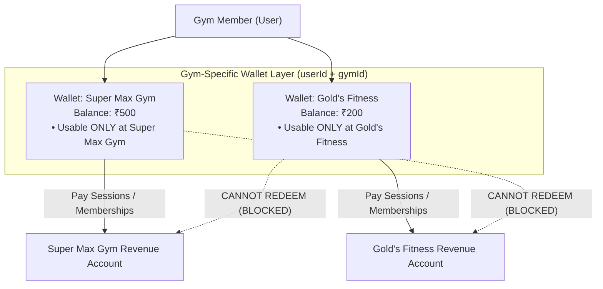
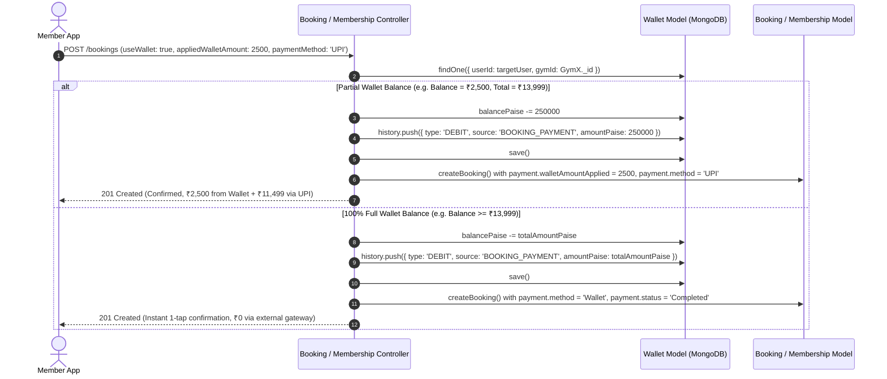

# Gym-Specific Wallet & Financial Ledger Architecture

This document specifies the multi-tenant wallet architecture and financial ledger engine for the **GYMEZY** platform.

---

## 1. Multi-Tenant Financial Boundary & Core Principle

In GYMEZY, partner gyms operate as independent financial and commercial entities. Revenue collection and payouts flow directly between gym members and specific gym owners.



### Architectural Invariant:
- **Strict Gym Isolation**: Every user wallet account is partitioned by `(userId, gymId)`.
- **No Cross-Gym Spending**: Funds held in a user's wallet for **Gym A** (such as membership downgrade credits, session cancellation refunds, or direct deposits) can **only** be redeemed at **Gym A**. They cannot be transferred, pooled, or redeemed for bookings or memberships at **Gym B**.

---

## 2. Database Schema & Data Models

### 2.1 The `Wallet` Collection
Defined in [`middleware/src/models/wallet.model.js`](file:///Users/yovelr/Softrate/GYMEZY/middleware/src/models/wallet.model.js):

```javascript
const walletSchema = new mongoose.Schema(
  {
    userId: {
      type: mongoose.Schema.Types.ObjectId,
      ref: 'User',
      required: true,
      index: true,
    },
    gymId: {
      type: mongoose.Schema.Types.ObjectId,
      ref: 'Gym',
      required: true,
      index: true,
    },
    balancePaise: {
      type: Number,
      required: true,
      default: 0,
      min: 0,
    },
    currency: {
      type: String,
      default: 'INR',
      trim: true,
    },
    history: [walletLedgerSchema],
  },
  { timestamps: true }
);

// Compound Unique Index: Strictly one wallet per user per gym
walletSchema.index({ userId: 1, gymId: 1 }, { unique: true });
```

### 2.2 Financial Ledger Schema (`history`)
Every credit or debit event produces an immutable ledger entry inside the wallet's `history` subdocument array:

| Field | Type | Description |
|---|---|---|
| `transactionId` | String | Unique reference identifier (e.g., `WAL_BOOK_...`, `WAL_MEM_...`, `WAL_TOP_...`) |
| `type` | String | `'CREDIT'` or `'DEBIT'` |
| `source` | String | Transaction reason: `'MEMBERSHIP_DOWNGRADE_PRORATION'`, `'MEMBERSHIP_PURCHASE'`, `'BOOKING_PAYMENT'`, `'TOP_UP'`, `'WALLET_WITHDRAWAL'`, `'ADMIN_ADJUSTMENT'`, `'REFUND_REVERSAL'` |
| `amountPaise` | Number | Transaction amount in Indian Paise ($\text{INR} \times 100$) |
| `balanceAfterPaise` | Number | Wallet balance immediately after the transaction |
| `referenceRequestId` | ObjectId | Optional reference to a linked `MembershipSwitchRequest` or Booking |
| `description` | String | Human-readable audit note (e.g. `Payment for booking at Super Max Gym`) |
| `createdAt` | Date | Timestamp of ledger entry |

---

## 3. Checkout Debit & Verification Lifecycle (Hybrid / Split Payment)

When a member books a session, class, or membership at **Gym X**:



---

## 4. REST API Specification

### 4.1 Get Consolidated Wallets List
- **Method**: `GET`
- **Route**: `/api/v1/wallet/my`
- **Query Params**: `userId` (optional), `gymId` (optional)
- **Response**:
```json
{
  "success": true,
  "data": {
    "totalBalanceINR": 700,
    "walletsCount": 2,
    "wallets": [
      {
        "id": "664fa7...",
        "gymId": "664fa1...",
        "gymName": "Super Max Gym",
        "gymLocation": "Porur, Chennai",
        "gymLogo": "https://...",
        "balanceINR": 500,
        "currency": "INR",
        "transactionsCount": 4
      },
      {
        "id": "664fb8...",
        "gymId": "664fa2...",
        "gymName": "Gold's Fitness",
        "gymLocation": "Anna Nagar, Chennai",
        "balanceINR": 200,
        "currency": "INR",
        "transactionsCount": 1
      }
    ],
    "transactions": [...]
  }
}
```

### 4.2 Get Specific Gym Wallet
- **Method**: `GET`
- **Route**: `/api/v1/wallet/gym/:gymId`
- **Response**:
```json
{
  "success": true,
  "data": {
    "gymId": "664fa1...",
    "gymName": "Super Max Gym",
    "gymLocation": "Porur, Chennai",
    "gymLogo": "https://...",
    "balancePaise": 50000,
    "balanceINR": 500,
    "currency": "INR",
    "exists": true,
    "transactionsCount": 4,
    "transactions": [...]
  }
}
```

### 4.3 Top Up Gym Wallet
- **Method**: `POST`
- **Route**: `/api/v1/wallet/top-up`
- **Payload**:
```json
{
  "gymId": "664fa1...",
  "amount": 1000,
  "paymentMethod": "UPI"
}
```
*Deposits ₹1,000 strictly into the user's wallet for the specified gym.*

### 4.4 Request Payout / Withdrawal
- **Method**: `POST`
- **Route**: `/api/v1/wallet/withdraw`
- **Payload**:
```json
{
  "gymId": "664fa1...",
  "amount": 500,
  "upiId": "member@okhdfcbank",
  "reason": "Downgrade credit payout"
}
```
*Debits ₹500 from the specified gym's wallet and submits a payout disbursement request.*

---

## 5. Mobile User Experience

1. **Card & Gym Accounts Breakdown (Option B Architecture)**:
   - The [`WalletScreen.js`](file:///Users/yovelr/Softrate/GYMEZY/mobile-application/user-react/src/pages/WalletScreen.js) features the signature GYMEZY Pass Hero Card at the top displaying the currently active gym's available balance, masked account suffix, and quick action pills (`Request Payout` and `Add Money`).
   - Directly underneath the hero card, the **Gym Accounts** breakdown list displays all linked gym wallets with individual balances, locations, and real-time active indicators.
   - Tapping any gym account in the list immediately switches the hero card, targets subsequent top-ups/payout requests to that gym, and filters the transaction history for that specific gym ledger.
   - Clunky horizontal pills and repetitive text are completely eliminated.
2. **Checkout Integration (Split / Partial Wallet Payment)**:
   - Both [`PaymentSummaryScreen.js`](file:///Users/yovelr/Softrate/GYMEZY/mobile-application/user-react/src/pages/PaymentSummaryScreen.js) (Sessions & Classes) and [`BuyMembershipScreen.js`](file:///Users/yovelr/Softrate/GYMEZY/mobile-application/user-react/src/pages/BuyMembershipScreen.js) (Memberships) fetch the user's available balance at the target gym.
   - If the user has a wallet balance at that gym, an interactive **Gym Wallet Offset Card** is displayed with a toggle checkbox.
   - **Partial Offset**: If the balance is less than the total (e.g. ₹2,500 available against a ₹13,999 total), the wallet applies a `-₹2,500` discount, and the remaining `₹11,499` is paid via secondary methods (`UPI`, `Card`, or `Net Banking`).
   - **Full Balance**: If the wallet balance completely covers the total amount, external gateways are hidden, and the user can complete their booking instantly with 1 tap (`Pay ₹0 with Wallet`).
   - Dynamic real-time calculation: `Total Amount - Wallet Balance Applied = Net Payable Amount`.
   - The CTA button dynamically reflects the exact breakdown (e.g. `Pay ₹11,499 (₹2,500 from Wallet)`).

