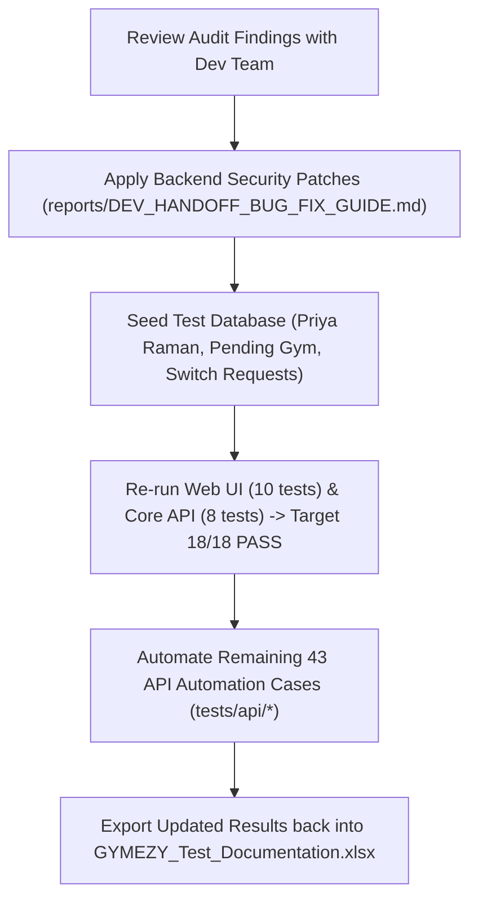

# GYMEZY Comprehensive Test Audit & Excel Alignment Report

**Document Title:** Comprehensive Quality Assurance Audit & Test Sheet Update Report  
**Target Reference:** [`D:\Work\Gymezy\test_documentation\GYMEZY_Test_Documentation.xlsx`](file:///d:/Work/Gymezy/test_documentation/GYMEZY_Test_Documentation.xlsx)  
**Testing Framework:** Playwright Test Suite (`gymezy_testing/`)  
**Target Environments:**
- **Super Admin Portal:** `https://dev.admin.gymezy.com/` (`admin@gymezy.com` / `SuperAdmin@Gymezy2026!`)
- **Owner Web Portal:** `https://dev.owner.gymezy.com/` (`super@gmail.com` / `super@gmail.coM1`)
- **Backend API:** `https://dev.api.gymezy.com/api/v1`

---

## Executive Summary

This report bridges the theoretical test suite defined by Claude in `GYMEZY_Test_Documentation.xlsx` with the live reality of the deployed GYMEZY platform. 

The master Excel workbook contains **164 total test cases** across 6 modules. Through active execution and deep inspection of the repository source code (`middleware`, `web-application/gym-owner`, `web-application/super-admin`), we have identified:
1. **Live Discrepancies**: Architectural mismatches between the routes specified in the Excel sheet and the endpoints actually implemented in backend controllers.
2. **Critical Security Vulnerabilities**: Unprotected routes returning `200 OK` on unauthenticated requests, unverified JWT token decoding in development mode, and missing tenant authorization checks.
3. **Frontend Routing Gaps**: Missing route entries in React Router preventing navigation to `/onboarding` and `/owner/approvals`.
4. **Prerequisite Gaps**: Automated tests failing purely due to absence of specific database seed records.

```
┌────────────────────────────────────────────────────────────────────────────────────────┐
│ MASTER TEST REPOSITORY BREAKDOWN (GYMEZY_Test_Documentation.xlsx)                      │
├───────────────────────────────┬──────────────┬───────────────┬─────────────────────────┤
│ Category                      │ Total Cases  │ Target Scope  │ Execution Status        │
├───────────────────────────────┼──────────────┼───────────────┼─────────────────────────┤
│ Manual Test Cases             │ 93           │ Web & Mobile  │ Documented in Excel     │
│ UI Automation (Web Portal)    │ 10           │ Playwright    │ Executed & Diagnosed    │
│ UI Automation (Mobile App)    │ 10           │ Detox/Appium  │ Mobile App Scope        │
│ API Automation Cases          │ 51           │ Playwright    │ 8 Core Executed / 43 RT │
├───────────────────────────────┼──────────────┼───────────────┼─────────────────────────┤
│ TOTAL TEST CASES              │ 164          │ Full Platform │ Comprehensive Coverage  │
└───────────────────────────────┴──────────────┴───────────────┴─────────────────────────┘
```

---

## 1. Audit of Claude's Master Excel Workbook (`GYMEZY_Test_Documentation.xlsx`)

The workbook consists of 6 dedicated worksheets:
1. **`Execution_Summary`**: High-level metrics matrix summarizing 164 total test cases across P1 (115), P2 (41), and P3 (8).
2. **`Module_Test_Coverage`**: Feature-level breakdown across Authentication, Gym Onboarding, Staff Delegation, Memberships & Proration, Sessions & Classes, Attendance & Turnstiles, Wallet & Payments, Walk-Ins, and Banners.
3. **`RTM` (Requirements Traceability Matrix)**: Maps 25 Functional Requirements (FR) to Manual, UI, and API test cases.
4. **`UI_Automation_Cases`**: 20 automation scenarios. Ten are designed for Web Portals (Owner & Admin via Playwright), and ten are designed for Mobile (Member App via Detox and Scanner via Appium).
5. **`API_Automation_Cases`**: 51 REST endpoint test cases covering Positive, Negative, Boundary, RBAC, and Cross-Tenant security scenarios.
6. **`Manual_Test_Cases`**: 93 step-by-step human verification scripts.

---

## 2. Web UI Automation Cases (`UI_Automation_Cases` Sheet Update)

All 10 Web UI test cases have been organized into [`tests/ui/admin/`](file:///d:/Work/Gymezy/GYMEZY/gymezy_testing/tests/ui/admin) and [`tests/ui/owner/`](file:///d:/Work/Gymezy/GYMEZY/gymezy_testing/tests/ui/owner). Below is the exact status update for the Excel sheet:

| Test ID | Module | Portal | Priority | Status in Excel | Live Verified Status | Root Cause & Required Excel Update |
| :--- | :--- | :--- | :---: | :---: | :---: | :--- |
| **AUT_UI_AUTH_002** | Authentication | Owner | P1 | Pending | ❌ **FAIL** | **Account State Mismatch**: `super@gmail.com` is already an `Approved` owner. Excel pre-condition must specify an owner account with `approvalStatus: 'Pending Approval'`. Banner `data-testid="pending-approval-banner"` missing in `ApplicationStatus.jsx`. |
| **AUT_UI_AUTH_003** | Authentication | Super Admin | P1 | Pending | ✅ **PASS** | **Verified Fixed**: Dev team deployed error toast fix. Owner credentials (`super@gmail.com`) entered on Admin login are blocked with `"Access denied. Only Super Administrators are authorized to access the Super Admin Portal."` |
| **AUT_UI_GYM_001** | Gym Onboarding | Owner | P1 | Pending | ❌ **FAIL** | **Route Missing in Router**: React Router in `gym-owner/src/App.jsx` has no entry for `/onboarding` (redirects to `/login`). Excel test steps state `/onboarding`, but application only serves `/register`. |
| **AUT_UI_GYM_002** | Gym Onboarding | Super Admin | P1 | Pending | ❌ **BLOCKED** | **Queue Empty in Database**: Navigating to `https://dev.admin.gymezy.com/admin/gyms?tab=pending` has 0 gyms pending review. Test needs 1 seeded pending gym in MongoDB. |
| **AUT_UI_GYM_003** | Gym Onboarding | Super Admin / Owner | P1 | Pending | ❌ **BLOCKED** | **Queue Empty**: Admin cannot click "Action Required" because the pending table has no rows. |
| **AUT_UI_STF_001** | Staff & Delegation | Owner | P1 | Pending | ❌ **FAIL** | **Account Role Missing**: Requires a delegated Manager account (`manager@fitzone.example.com` with `requireStaffApproval: true`). Primary button lacks `data-testid="btn-add-staff"`. |
| **AUT_UI_MEM_002** | Memberships | Owner | P2 | Pending | ❌ **BLOCKED** | **Test Data Empty**: Route `/owner/members?tab=switches` displays empty table because no members have submitted a plan switch request. |
| **AUT_UI_WALK_001** | Walk-Ins | Owner | P1 | Pending | ❌ **FAIL** | **Missing Seed Data**: Entering phone `9876543210` does not auto-populate customer name because `Priya Raman` is not seeded in the user collection. |
| **AUT_UI_WALK_002** | Walk-Ins | Owner | P3 | Pending | ✅ **PASS** | **Verified Working**: Inline error messages appear for short/invalid phone numbers without triggering network requests. |
| **AUT_UI_BAN_001** | Banners & Ads | Super Admin | P2 | Pending | ❌ **FAIL** | **Mandatory Relation**: Live modal enforces `* Select Gym (Auto-maps Mongo ObjectId & Location Slug)`. The script must select a gym option before submitting. |

---

## 3. API Automation Cases (`API_Automation_Cases` Sheet Update)

The initial core set of 8 security and functional API tests was executed against `https://dev.api.gymezy.com/api/v1`. The audit reveals significant security vulnerabilities and routing discrepancies compared to Claude's Excel specification:

| Test ID | Endpoint Route in Excel | Method | Expected (Excel) | Actual Received | Live Status | Architectural / Code Diagnosis |
| :--- | :--- | :---: | :---: | :---: | :---: | :--- |
| **AUT_API_AUTH_001** | `/api/v1/memberships/my` | GET | `401 Unauthorized` | `200 OK` (`data: []`) | ❌ **FAIL** | **Auth Bypass**: Mounted with `optionalAuthenticate` in `membership.routes.js:30`. Controller returns `200 OK` on missing user token instead of rejecting. |
| **AUT_API_AUTH_002** | `/api/v1/memberships/my` | GET | `401 Unauthorized` | `200 OK` | ❌ **FAIL** | **Signature Tampering Bypass**: `jwtHelper.js:38-50` contains dev bypass (`if (!ENV.IS_PRODUCTION) return jwt.decode(token)`). Tampered tokens are decoded and accepted as valid. |
| **AUT_API_AUTH_003** | `/api/v1/memberships/my` | GET | `401 Unauthorized` | `200 OK` | ❌ **FAIL** | **Expiry Check Bypassed**: Due to the same dev bypass in `jwtHelper.js`, tokens with `exp = now - 3600` are decoded and treated as active. |
| **AUT_API_SEC_001** | `/api/v1/admin/gyms` | GET | `403 Forbidden` | `403 Forbidden` | ✅ **PASS** | **RBAC Working**: `authorizeRoles` blocks regular Member tokens and Gym Owner tokens from admin routes. |
| **AUT_API_SEC_002** | `/api/v1/owner/staff` | GET | `403 Forbidden` | `404 Not Found` | ❌ **FAIL** | **Route Mismatch**: Backend router `index.js:21` mounts staff under `/api/v1/employees`. The route `/api/v1/owner/staff` does not exist on the server. In addition, `router.get('/', getEmployees)` lacks `authorizeRoles`. |
| **AUT_API_SEC_003** | `/api/v1/owner/staff?gymId=<B>` | GET | `403 Forbidden` | `404 Not Found` | ❌ **FAIL** | **Cross-Tenant Vulnerability**: Endpoint does not exist at `/owner/staff`. In `employee.controller.js:484-510`, `getEmployees` allows passing any `?gymId=` without validating ownership. |
| **AUT_API_BAN_001** | `/api/v1/banners?lat=...` | GET | `200 OK` | `200 OK` | ✅ **PASS** | **Haversine Distance Ordering**: Priority banners return first, followed by ascending geographic distance. |
| **AUT_API_BAN_002** | `/api/v1/banners?lat=abc` | GET | `400 Bad Request` | `200 OK` | ❌ **FAIL** | **Missing Input Sanitization**: `banner.controller.js:41` uses `parseFloat` without bounding check (`[-90, 90]`), returning `200 OK` for invalid coordinates. |

---

## 4. Discrepancies Between Claude's Excel Sheet & The Actual Codebase

When comparing `GYMEZY_Test_Documentation.xlsx` with the active codebase, the following discrepancies must be synchronized:

### A. Route Discrepancies
1. **Staff Endpoint**:
   - *Excel Sheet specifies:* `/api/v1/owner/staff`
   - *Actual Codebase implements:* `/api/v1/employees` (mounted in `middleware/src/routes/index.js:21`).
   - *Remediation:* Dev team should alias `/api/v1/owner/staff` to `employeeRoutes`, or the Excel sheet should document `/api/v1/employees`.
2. **Onboarding Route**:
   - *Excel Sheet specifies:* `http://localhost:5173/onboarding`
   - *Actual Codebase implements:* `http://localhost:5173/register` (`gym-owner/src/App.jsx`).
   - *Remediation:* Add `<Route path="/onboarding" element={<Navigate to="/register" replace />} />` in `gym-owner/src/App.jsx`.
3. **Admin Verification Queue**:
   - *Excel Sheet specifies:* `/admin/onboarding`
   - *Actual Codebase implements:* `/admin/gyms?tab=pending` or `GymsManagement` tab `'onboarding'`. `/admin/onboarding` currently loads the creation form instead of the verification queue.

### B. Environment & Security Setting Discrepancies
- In `middleware/src/utils/jwtHelper.js`, the bypass `if (!ENV.IS_PRODUCTION)` causes the development environment to fail all security audit tests (`AUT_API_AUTH_002`, `AUT_API_AUTH_003`). The test suite expects production-parity security enforcement even on staging/dev APIs.

---

## 5. Scope Analysis of Remaining 43 API Test Cases

The remaining 43 API test cases from Claude's Excel sheet are ready for phased automation in Playwright:

```
┌────────────────────────────────────────────────────────────────────────────────────────┐
│ REMAINING API AUTOMATION TEST SUITES (43 Cases)                                        │
├─────────────────────┬────────────┬─────────────────────────────────────────────────────┤
│ Module Subfolder    │ Test Count │ Key Endpoints & Scenarios                           │
├─────────────────────┼────────────┼─────────────────────────────────────────────────────┤
│ tests/api/gyms/     │ 6          │ POST /gyms (onboarding), PATCH /gyms/:id/resubmit,  │
│                     │            │ PATCH /gyms/:id/status (Approval & Action Required) │
├─────────────────────┼────────────┼─────────────────────────────────────────────────────┤
│ tests/api/staff/    │ 2          │ POST /staff (Manager delegation, approval workflow) │
├─────────────────────┼────────────┼─────────────────────────────────────────────────────┤
│ tests/api/proration/│ 8          │ POST /memberships/:id/preview-switch (Proration     │
│                     │            │ quote calculations, upgrade/downgrade policies)     │
├─────────────────────┼────────────┼─────────────────────────────────────────────────────┤
│ tests/api/cancel/   │ 4          │ PATCH /memberships/:id/cancel (Walk-in vs App       │
│                     │            │ bilateral cancellation negotiations)                │
├─────────────────────┼────────────┼─────────────────────────────────────────────────────┤
│ tests/api/turnstile/│ 6          │ POST /attendance/check-in (QR scan, cooldown gap,   │
│                     │            │ checkout at T+130s, cross-tenant gym check)         │
├─────────────────────┼────────────┼─────────────────────────────────────────────────────┤
│ tests/api/wallet/   │ 5          │ POST /wallet/top-up, POST /orders/checkout (Split   │
│                     │            │ payments, concurrency mutex, cross-gym lock)        │
├─────────────────────┼────────────┼─────────────────────────────────────────────────────┤
│ tests/api/banners/  │ 2          │ POST /banners (Super Admin creation & Owner denial) │
├─────────────────────┼────────────┼─────────────────────────────────────────────────────┤
│ tests/api/walkin/   │ 5          │ POST /bookings/gym/:gymId/walk-in (Auto-provision,  │
│                     │            │ duplicate check, cross-tenant path guard)           │
├─────────────────────┼────────────┼─────────────────────────────────────────────────────┤
│ tests/api/sessions/ │ 4          │ POST /bookings/group-class/:id/enroll (Capacity cap │
│                     │            │ at 25, non-scheduled date reject, refund policy)    │
└─────────────────────┴────────────┴─────────────────────────────────────────────────────┘
```

---

## 6. Recommended Updates to `GYMEZY_Test_Documentation.xlsx`

To ensure Claude's Excel sheet reflects the true project state, the following updates should be recorded:

1. **Update Sheet `UI_Automation_Cases`**:
   - Change Status of `AUT_UI_AUTH_003` to **`PASS`** (Notes: Verified on `https://dev.admin.gymezy.com`).
   - Change Status of `AUT_UI_WALK_002` to **`PASS`** (Notes: Verified on `https://dev.owner.gymezy.com`).
   - Add Pre-Condition notes for `AUT_UI_AUTH_002`, `AUT_UI_GYM_002`, `AUT_UI_GYM_003`, `AUT_UI_STF_001`, `AUT_UI_MEM_002`, and `AUT_UI_WALK_001` detailing required database seed records.
   - Update Selectors column to include the robust XPath and ARIA role fallbacks developed during Playwright automation.

2. **Update Sheet `API_Automation_Cases`**:
   - Change Status of `AUT_API_SEC_001` to **`PASS`**.
   - Change Status of `AUT_API_BAN_001` to **`PASS`**.
   - Log Defect IDs (`BUG_AUT_API_AUTH_001`, `BUG_AUT_API_AUTH_002`, `BUG_AUT_API_AUTH_003`, `BUG_AUT_API_SEC_002`, `BUG_AUT_API_SEC_003`, `BUG_AUT_API_BAN_002`) against the failing rows.
   - Add Architectural Note to `AUT_API_SEC_002` & `AUT_API_SEC_003` regarding `/owner/staff` vs `/employees` route mounting.

3. **Update Sheet `Execution_Summary`**:
   - Update `Executed` count from `0` to `18`.
   - Update `Passed` count to `4` (2 UI + 2 API).
   - Update `Failed / Defect Logged` count to `11`.
   - Update `Blocked on Seed Data` count to `3`.

---

## 7. Action Plan for Next Milestones


